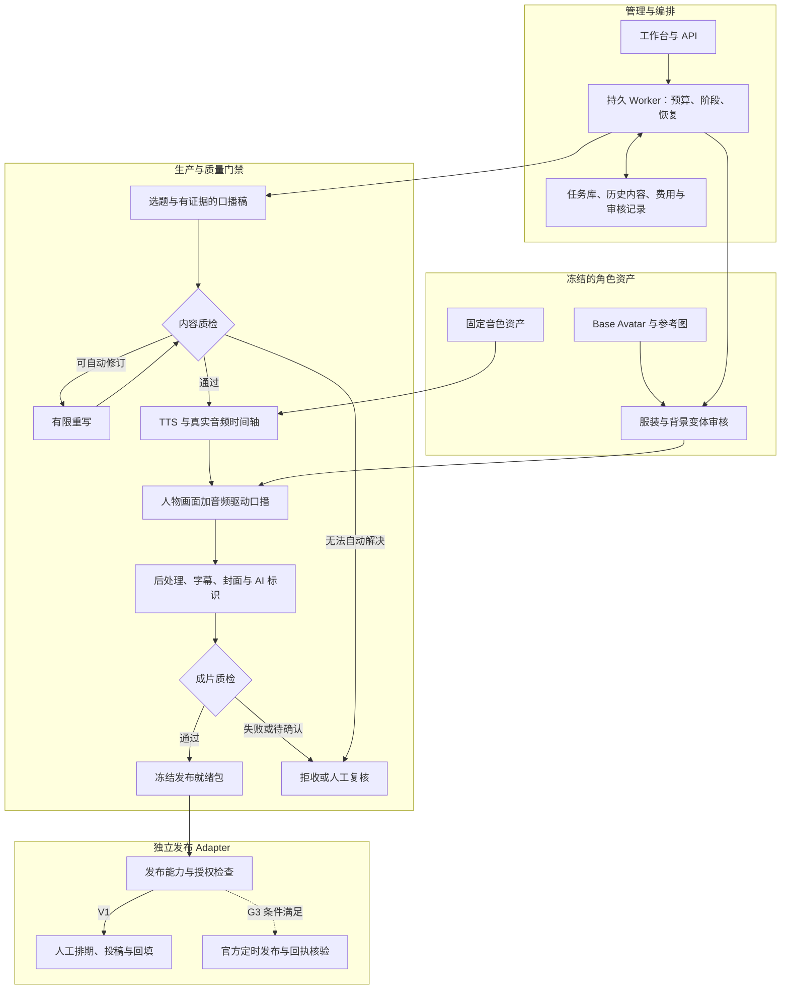

# 技术方案（已回填核心模型决策，接入与质量待验收）

版本：v0.7 Model Decisions；日期：2026-09-21。

具体输入→模型/技术→产物的逐环节展开见 [端到端技术流程与模型选型地图](08-端到端技术流程与模型选型地图.md)。该补充文档已更新核心模型，准确渠道与请求型号见 [模型选型决策与接入方案](09-模型选型决策与接入方案.md)；其余工程栈仍为候选。

本文保留需求驱动的逻辑边界，已写入用户选定的四个核心模型；其他技术实现继续按环节测试与决策。本轮已执行获授权的数字人口播隔离试验，尚未实现生产系统或向抖音发布作品；实测只用于记录已验证约束与风险。调研中标为“实测”的内容是调研作者当时的证据，与 [本项目首轮结果](../selection/01-数字人口播/02-首轮实测结果.md) 分别记录。

变更记录：v0.2 落实用户“整个项目从零重建”的决策；以 `avatar_studio` 建立新工程边界，重新设计模块、schema、配置、资产、测试与阈值，不提供旧项目兼容层。

**当前核心模型：MuseTalk 1.5 自部署；MiniMax 官方 `speech-2.8-hd`；GPT 专用中转 `gpt-image-2`；DeepSeek 官方 `deepseek-flash`（版本 DeepSeek-V4.1-Flash）。** 四项均为 SELECTED_BY_USER，质量验收为 PENDING_ACCEPTANCE。选择来源是本轮明确用户决定，不能把它写成全部实测通过；前后端、数据库、队列、embedding 和 ASR 等仍待选定。
流程及正式写入条件见 [技术选型与实测流程](07-技术选型与实测流程.md)。

V1 已确定先实现真实生产全链路与发布就绪包；V2 在官方资质、权限和调用能力实证后单独验收自动发布。阶段口径为：G0 文档基线；G1 真人角色与声音定版、真实样片；G2 生产链路与发布辅助；G3 授权自动发布全链路。Mock 是 G0→G1 期间的开发检查，不是任何真实能力验收。G2 不等于 G3。枚举、实体字段与 API 以 [04-接口契约与数据字典.md](04-接口契约与数据字典.md) 为真相源。

## 1. 设计边界和依据

生产输入是固定写实成年虚拟主播、批准的服装/背景变体、固定音色和已审口播稿。数字人口播必须实际调用图像加音频驱动能力，禁止 T2V，禁止用嘴部形变、静态头像或模拟音频满足生产验收。

本机负责资产管理、内容/质量判断、任务编排、后处理与审查；媒体生成由独立 Provider 承担，可以是供应商 API 或自托管 GPU Worker。用户已选择 MuseTalk 算力云自托管，以降低持续 API 支出。具体部署、自然动作来源与实际成本须通过 [MuseTalk 试验方案](../selection/01-数字人口播/03-MuseTalk云端部署与试验方案.md) 验证；单图局部唇形不等于完整自然主播。图像、TTS 和文本已明确为 GPT Image 2、MiniMax Speech 2.8 HD 和 DeepSeek V4.1 Flash；其他环节继续独立选型。

**排除范围：demo 的源码、README、配置、数据库、人物和声音素材、成片、测试夹具与阈值均不阅读、导入或借鉴。** 调研中涉及 demo 现状、复用、改造及既有测试结果的章节同样不作为新项目依据；只采用以下资料中能独立追溯到厂商、开源项目或平台的事实：

- [01 产品形态与抖音生态](../research/01-产品形态与抖音生态.md)：内容方向、AI 标识与投稿权限边界。
- [02 人物一致性生成](../research/02-人物一致性生成.md)：参考图 API 能力、上游硬件声明与许可证事实。
- [03 数字人口播选型](../research/03-数字人口播选型.md)：云端/开源口播产品、输入限制、额度与厂商计价；不采用其面向旧工程的接口和质检设计。
- [04 TTS 与内容质检](../research/04-TTS音色与内容生成质检.md)：TTS 型号、表达控制与音色使用条款；内容模块由本次需求重新设计。
- [05 后处理与发布](../research/05-视频后处理发布与合规.md)：FFmpeg 能力、真实时间戳及平台权限/规则；后处理、封面与发布 Adapter 独立设计。
- [06 决策汇总](../research/06-决策汇总.md)：仅可回溯原始外部来源的权限、许可证和待核验事实。V1/G3 分期依据用户确认，不根据调研结论改变范围。

## 2. 总体架构与首期部署

本节确定业务责任；核心模型与渠道见[模型决策](09-模型选型决策与接入方案.md)，语言、框架、数据库与队列尚未选定。
管理入口负责验证请求和展示进度；可恢复的执行单元负责长时间媒体任务；
持久状态须统一记录任务、预算、审批与发布结果；媒体存储提供可追溯资产和受控取材。
这些能力可由不同技术组合实现，具体组合通过相应选型实验决定。

| 选型对象 | 当前状态 | 待提交的比较证据 |
|---|---|---|
| 图片＋音频数字人口播 | SELECTED_BY_USER：MuseTalk 1.5；已有短片，质量待验收 | 完整身份/口型/动作评价、实时末帧修复的新任务验证、真实目标时长与重复样本、合格产出成本 |
| API 与语言框架 | UNSELECTED | 同一接口契约的实现复杂度、依赖、运行与维护结果 |
| 数据库与向量检索 | UNSELECTED | 相同数据和故障条件下的检索、原子预算、恢复、备份结果 |
| 任务执行与调度 | UNSELECTED | 同一异步模型下的崩溃、重复触发、未知受理和恢复测试 |
| 图像、TTS、文本 | SELECTED_BY_USER：GPT Image 2 / speech-2.8-hd / DeepSeek V4.1 Flash | 各自账号接入、固定身份/音色、结构、质量与用量验证 |
| 质量与媒体处理 | UNSELECTED；保留 FFmpeg 等工具候选 | 标定、许可与资源成本 |
| 工作台框架与部署 | UNSELECTED | 相同操作流程、构建、兼容性与部署验证 |

SQLite、Vue、FastAPI、Celery 等工程组件仍须另行选定；四个生成模型按用户决定回填，不连带选择工程框架。
概念架构图中的“数据库”“Worker”表示责任，不意味着某个数据库或任务框架已经选定。

### 2.1 目标架构与关键门禁

下图是拟实现架构；实线是 V1 生产与发布辅助流程，虚线是权限验证后才启用的自动发布。
质检放行绑定具体输入版本，人工复核通过后从对应阶段恢复，不跳过后续门禁。



数字人口播只接收已批准人物画面和真实音频。每个阶段产物通过统一资产库登记；
云端媒体使用私有对象存储临时授权，图中任务库不保存大视频。

### 2.2 职责划分草案（目录待工程栈选定后重写）

未来从空目录创建下列工程，包名固定为 `avatar_studio`。本轮不创建其中任何实现文件：

```text
production/
  pyproject.toml
  config/config.example.yaml
  src/avatar_studio/
    contracts/               公共枚举、请求结果、错误与能力声明
    storage/                 全新 schema、后续版本升级、资产清单与对象存储
    providers/               真实服务与 Mock 的独立适配器
    avatar/                  身份版本与变体审批
    content/                 选题、证据、稿件、历史与重写
    tts/                     音色、表达编译与时间信息
    digital_human/           异步口播作业与结果校验
    video/                   时间线、ffmpeg、字幕、封面与标识
    quality/                 内容/视频门禁与人工复核
    pipeline/                阶段、lease、恢复、预算与事件
    publish/                 就绪包、排期、回填与未来官方 Adapter
    api/                     管理 API、鉴权与媒体访问
    cli.py                   薄命令入口，含独立 Worker 启动
  tests/                     新契约测试、故障注入与独立新建夹具
  frontend/
  scripts/
  runtime/                   按模式隔离的全新数据库、资产和证据
```

关键调用方向：API → 应用用例 → 领域规则 → Repository/Provider；Worker 复用相同应用用例。Provider 不直接写业务任务完成状态，媒体模块不自行发布内容，发布模块不擅自重做视频。

## 3. 从零构建与模块边界

### 3.1 新系统基线

领域规则、API、Provider 适配器、执行器、前端、schema、配置和测试在各自选型完成后重新实现。数据库由新 schema 第 1 版初始化为空库；配置从新示例显式填写，凭据使用 `AVATAR_STUDIO_` 命名空间。安装和启动只解析新工程的配置与运行目录，不探测旧目录，不读取旧库，不提供兼容包、旧字段转换或历史资产导入工具。

首次人物候选、参考图、服装/背景素材、音色创建/注册、基准音频和质量样本均为新项目建立来源记录。只有新系统产生或为新项目独立取得授权并登记的材料可进入资产审批；旧头像、声音 ID、成片、报告与审批结果均不进入新资产库。新项目自身的后续版本保留追溯关系，不据此提供旧系统兼容。

### 3.2 模块责任

| 边界 | 输入与职责 | 持有的数据与输出 |
|---|---|---|
| 资产与来源 | 新生成/新授权素材、权利材料；人物与声音版本审批 | SourceRecord、AvatarIdentity、AvatarVariant、VoiceAsset 和不可变摘要 |
| 内容与证据 | 选题、可信来源和栏目要求；结构化生成、查重、断言核对与有界重写 | ScriptVersion、ContentSource、内容质量报告 |
| 语音与数字人 | 批准稿、已批准声音、已批准人物图；表达编译、TTS、真实音频驱动 | 实际音频、ProviderRun、原始口播视频及时间信息 |
| 媒体与质量 | 音视频资产与时间线；编码、字幕、封面、标识及质量检查 | EditTimeline、成片资产、可审查的 QualityReport |
| 编排与成本 | 阶段依赖、能力、授权预算；领取、持久恢复、未知结果核对 | Task、StageExecution、费用预留/结算、事件与租约 |
| 发布管理 | 已批准发布包、排期和明确发布权限 | V1 就绪包、提醒与人工报告；G3 条件满足后的官方状态 |

模块之间仅通过 [04 契约](04-接口契约与数据字典.md) 和稳定引用交互。Provider 只返回外部结果，不越权批准身份、改预算或置生产成功；质量模块报告证据，编排模块据规则推进。发布状态与生产状态分别持久化。

### 3.3 新测试与标定

先写新契约和副作用测试，再实现对应模块。Mock 为从零编写的确定性契约模拟器，可配置受理、排队、成功、失败、超时和未知结果；媒体测试只生成带模拟标记的测试图案、音频与容器文件，不实现人物口型形变或真实能力预览。所有 Mock 输出及其后代保持 `simulated=true`。

离线正负例、崩溃/并发/丢响应夹具由新测试规范独立创建。身份、音色、语义重复、音画同步和视觉质量阈值以新来源样本及人工标注重新标定；未标定项保持待审，不导入既有阈值。真实质量的 G1/G2 验收使用新项目受控生成的样片和完整来源证据。

## 4. 身份、服装和背景资产

### 4.1 不可变 Base Avatar

2026-09-22 已确认人物 B 为固定身份 `av_base_b_v1`，音色 3 为 `voice_minimax_warm_bestie_v1`，已保存原图、基准音频、来源及摘要。见 [人物与音色定版记录](../selection/03-人物与音色/02-人物B与音色3定版记录.md)。当前完成选型资产登记，实际变体和数字人口播生产质量仍待验收。

首次通过用户指定中转的 `gpt-image-2` 创建全 AI 生成的写实成年虚拟主播，由人工批准 hero 和参考集。保存生成来源、模型版本、参数、使用权证据、文件摘要和身份描述；后续视频只能引用该固定版本。数据库与文件存储均禁止原地覆盖 hero；更换身份创建新 ID，不能用“重新生成”悄悄替换长期人设。

服装与背景是业务配置上的独立维度，采用已选 `gpt-image-2` 的固定参考图编辑方向；中转参考图协议、保护能力和身份保持必须先验证，不预设已经支持。不把业务解耦强行实现成头、躯干、背景的硬贴图；严格分层合成只在后续有明确固定机位需求且样片通过时启用。

批准的 AvatarVariant 可以复用，不必每期收费重画。同一变体只要输入参考和参数摘要不同便创建新版本；未通过身份门禁的图不得交给口播 Provider。图像服务切换会触发新变体评审，而不是自动当作同一人。

### 4.2 身份门禁

先做文件、分辨率、人物数量、脸部可见性等确定性检查，再与 Base Avatar 对照五官、脸型、发型、肤色、年龄感和主体比例。自动相似度只在模型权重及依赖许可证可用于本项目、阈值经过正负样本校准后启用；模型代码 MIT 不等于预训练权重可商用。

在许可证或阈值未完成时，流程进入 `waiting_review`，人工逐张批准并绑定图片摘要。该路线可以交付有人工门禁的 G1/G2，不能声称自动身份识别已经验收。禁止直接采用调研中的 ArcFace 固定 0.6 等经验数值充当产品标准，禁止为了通过而生成一个伪相似度。

不默认接入 GFPGAN/CodeFormer 人脸重建，避免身份漂移。变体批准后，还须在口播关键帧复核同一身份，不能只检查输入图。

## 5. 内容生成、质检与重写

选题支持人工指定、维护的主题池和已授权的信息来源。首期无需依赖不可稳定访问的抖音登录抓取；热点不足时使用常青选题，并标明信息截止时间。

已选 DeepSeek V4.1 Flash（官方请求 `deepseek-flash`）输出结构化 ScriptVersion：主题、标题、简介、标签、原文、分段、断言与来源引用。稿件的一切外部网页/文档内容均作为不可信数据处理；检索结果不能指示系统更改预算、秘密、Provider 或发布权限。

内容质量分三层：

1. 确定性硬检查：字段完整、长度、禁用词、文本格式、明显重复、引用范围有效。
2. 证据检查：提取具体数字、产品能力、价格、日期、政策等断言，匹配来源摘录和时间；检索不到则 `unverified`，关键断言进入人工处理或改写删除。无联网/证据情况下不输出虚假的 factuality、timeliness 高分。
3. 编辑质量：开头是否清楚、单条知识点、口语表达、逻辑和信息密度；与历史主题、观点、结构做语义近邻比较。模型和阈值版本必须记录，不能把字符 3-gram 与语义余弦取 max 混成统一度量。

语义去重的候选包括本地 embedding 与云 embedding；在相同人工标注集上比较误报、漏报、耗时、资源与费用后，再确定模型与部署。模型升级要重建向量或分版本检索，不能直接混用向量空间。阈值未校准时输出疑似重复候选供人工判断。

重写按失败原因进行：补证据、缩短、去套话、换例子或重组结构。用户指定选题不得自动换题；自动选题才可在授权策略中换题。每期初始稿后最多 3 次自动重写，次数、token 和费用上限均可配置且受预算政策约束。每版原稿、反馈和修订记录都保留；最高分但硬门禁失败的稿件仍不能进入 TTS。

## 6. 固定音色和表达编译

VoiceAsset 绑定 `provider + model + region + remote_voice_id`，从新项目首次声音创建或注册开始，冻结新参考音频与基础参数。当前 TTS 已选 MiniMax 官方 `speech-2.8-hd` 及系统音色 3“温暖闺蜜”，固定 `remote_voice_id=Chinese (Mandarin)_Warm_Bestie`，不默认克隆真实个人；如使用新取得授权的声音，记录权利范围和有效期。

Qwen Voice Design 与 CosyVoice 仅保留为历史调研对照，本轮不接入；MiniMax 固定音色绑定同样遵守：**同一云厂商也不意味着音色 ID 跨模型有效**。优先选择官方明确支持的一整套“设计/创建 → 指定 TTS 型号合成”链路；若必须重建音色，创建新资产并通过基准句、术语发音和盲听评审。供应商不可用时暂停或切换已经单独批准的备用 VoiceAsset，禁止静默切到通用音色。

稿件标注与合成编译分层：LLM 只产生范围式停顿、重音、语速、情绪、读法标注，确定性编译器负责转为目标服务的参数。标注后原文必须逐字不变；发音替换单独记录从原文到朗读文本的映射，字幕仍显示原文。

Provider 能力不支持某个必需表达时拒绝请求；经批准的近似方式可以使用，但必须在结果记录精确丢失了什么能力。并不把“参数已提交”当作实际表达效果通过。对技术术语和英文缩写建立词典，基准样例包括 RAG、API、模型名称、多音字、数字单位。

输出音频先检查可解码性、时长、过度静音、削波、漏读/重复、音色连续性；没有可商用且已校准的声纹模型时用人工基准盲听门禁。原生时间戳按当前模型/音色验证；无可靠时间戳转 ASR/强制对齐，不得用按字数均分时间替代生产对齐。

## 7. 真正的数字人口播

当前生产口播方向已经选定 MuseTalk 1.5 自部署，火山与阿里原片保留为已完成的质量对照，不设置为自动付费回退；MuseTalk 最大输入、清晰度、并发和完整产能在 G1 前通过受控测试确认。单条能否达到目标时长未知时，能力注册表标 `unverified`，不能直接把 60–75 秒请求投入队列。

2026-09-21 的 [TH-AB-001 首轮实测](../selection/01-数字人口播/02-首轮实测结果.md) 仅补充以下约束与风险，不冻结供应商或生产实现：

- 同一张新建 1080×1920 图和 9.36 秒原始 WAV 已分别提交一次。WAV 为 24 kHz/单声道/PCM16，RIFF/data 长度占位而完整 PCM 可解码；时长应结合实际帧数验证，不能仅依赖占位头字段。低于原 10 秒目标下限的偏差已事前登记，不能宣称覆盖原 10～15 秒范围。
- 阿里 `wan2.2-s2v` 的图片检测 check_pass=true，720P 请求返回原片；测得 720×1280、H.264/AAC、帧率字段 30 fps、274 帧、9.133333 秒，全片解码无报错。这仅验证本样本生成与媒体读取；总时长差不是音素同步误差，不能由编码参数推定口型或身份通过。
- 火山 OmniHuman 1.5 返回 HTTP 401 / code 50400 / Access Denied，未取得 task_id 或原片且未重试。当前无法定位具体权限层，也不能直接归因为 Key 错误；账号开通声明不能替代精确接口调用证据。
- 费用预留 47 元，实际待对账；53 项离线保护测试仅验证本地执行保护。完整主观视听仍为 NOT_REVIEWED，A/B 比较不完整，决策保持 UNSELECTED；长片、重复样本和生产恢复尚未验收。

完整生命周期：校验已批准人像和音频 → 查幂等记录 → 预算预留 → 持久化提交意图 → submit → 存远端 ID → 短轮询 → 下载 → 解码校验 → 身份/口型质量检查 → 成本结算。

`submit/poll/download` 由适配器统一，但业务层仍可识别 Provider 差异。不能把长同步 HTTP 封装成一个“generate 成功”就丢弃远端任务。轮询默认建议 10–15 秒并加 jitter，最终频率服从提供商要求；超过本地等待期限不是云任务已失败。

本轮对比串行执行，并按每个候选已核实的账号/地域/模型配额约束请求。生产并发配置在实测选型后填写。云任务未结束或状态 unknown 时仍需核对实际占用；执行器租约过期不等于云任务结束。

备用 Provider 的分段必须基于真实时长上限按句切分。每段复用同一已批准头像与音色，记录原始音频区间和输出时间轴；默认不用重叠音频拼接，若确需重叠上下文，输出先去重裁剪再拼接。逐段确认身份、语音无重复/漏词、画面无明显跳变后才允许成片。报价按所有计费片段总时长预留，不能按最终去重时长少算。

MuseTalk 1.5 已在用户租用实例中隔离部署，实际报告 RTX 4080 / 32GB，四项短样片已产出。单图进程约 99 秒，母版准备约 106 秒，同进程缓存生成约 23～26 秒；整卡每秒采样峰值约 7.3GiB。这些是该素材/设备的有限测量，不能作为全链路 SLA 或最低显存保证。它重绘 256×256 脸区，头动通常继承输入母版，完整视听与长片仍待验收。官方实时路径少一帧的问题已定位，独立修复入口离线通过但尚未重新 GPU 出片。缓存不是训练，也不是已具备鉴权与调度的生产 API；失效与目录隔离须显式设计。详见 [部署与首测结果](../selection/01-数字人口播/04-MuseTalk部署与首测结果.md)。Wav2Lip 开源非商业路线不进入生产白名单；未来口播模块只实现真实音频驱动适配器与契约 Mock，不提供几何嘴型生成器。

## 8. 后处理、字幕、封面与质量门禁

后处理单链路用 ffmpeg，保留输入与参数证据：探测 → 确定裁剪 → 统一分辨率/帧率 → 必要的轻量降噪锐化 → 两遍响度标准化 → 字幕/标识/包装 → 编码封装 → 最终探测。避免独立模块各自有损转码多次；若需要中间文件应保存可核对的处理步骤。

建议输出规格：1080×1920、30 fps CFR、H.264 high、yuv420p、AAC 48 kHz/192 kbps、faststart；编码起点 CRF 20、preset slow，响度目标 -14 LUFS、true peak 不高于 -1.5 dBTP、LRA 11。参数是工程起点，最终容差以验收文档为准；720P 输入放大到 1080P 只满足容器尺寸，不等于原生 1080P 细节或真人画质。

去首尾必须联合音频静音和视频黑帧判断，保护第一字、尾音与自然停顿；不能删除句中静音。裁剪决定先固化 EditTimeline，再统一映射字幕、封面候选和音画检测窗口。片头片尾、云端前导帧、分段拼接都会改变偏移，具体公式和可解析示例见契约。

字幕优先真实 TTS 时间戳，回退为 ASR/强制对齐。单行建议不超过 14 个中文字符、最多两行，底部安全区起点 320 px@1080×1920、描边 3–4 px；用真实画面和平台遮挡预览检查，不能仅凭文本字数判定布局通过。封面来自批准成片或同一身份的批准图，保存可商用字体来源。

AI 标识包括持续可见的显式说明、经核实规范写入的隐式字段、manifest 记录，以及发布包中的平台声明提示。任意 mp4 自定义 comment 不等于符合现行标准；法定/平台具体字段及要求需上线前核对，未验证时相应门禁待审。V1 人工发布者须按包提示完成平台声明，系统记录的是操作报告，不伪装为官方验证。

视频门禁分工如下：

- 自动硬门禁：可解码、流和分辨率/帧率、时长/响度容差、字幕范围与覆盖、文件摘要、AI 标识检查、资产来源与 `simulated=false`。
- 自动辅助：黑帧、长静止、嘴部矩形伪影、口型与声音粗相关、清晰度异常。这些指标用于筛查，相关系数高不能证明音素唇形自然，锐化也不能证明真人质感。
- 人工实质验收：同一人、真人画质、真实唇形同步、自然头部/眼神微动、没有机械嘴巴和扭曲、音色/术语正确、分段连续。初始所有 G1/G2 成片保留该门禁，形成金标后再讨论缩小抽检范围。

评分不能抵消关键失败。质量未通过或未检查的产物保持候选状态，不能因已花钱而强行出包。

## 9. 持久编排、幂等与恢复

### 9.1 首期任务表和事务

逻辑表包括 `tasks`、`stage_executions`、`provider_runs`、`media_assets`、`quality_reports`、`review_decisions`、`cost_reservations`、`publications`、`events`、`outbox`、`resource_slots`。身份、音色、脚本版本及配置快照独立保存。模式、状态、时间等需要检索的字段用列，非索引参数用有 schema 的 JSON，不做一个无限扩张的 meta_json。

状态存储与执行器必须证明领取任务的原子性、租约和过期执行者隔离，以及并发预算检查。
具体数据库事务、锁机制、执行进程数与部署限制由同一故障测试的结果决定，
不能在选型前指定 WAL、数据库专有语句或单进程为唯一方案。

外部网络调用绝不持有 DB 写事务。阶段结果写入时核对 lease/fencing_token、输入摘要与当前状态，防止旧 Worker 覆盖新结果。Worker crash 恢复后先扫描过期 lease；已知远端 ID 的任务恢复 poll，未确认提交的任务转核对。不能把所有过期 `running` 无条件改回可提交。

状态更新、追加 events、写 outbox 在一个本地事务完成。outbox 至少一次消费，按事件 ID 去重。对收费 submit，outbox 的重投只重新进入 ProviderRun 状态检查，绝不直接再发同一个不具幂等保障的 HTTP POST。

### 9.2 各层幂等

- 用户命令：`Idempotency-Key + 规范化请求摘要`，同 key 不同请求冲突。
- 阶段缓存：`stage + 输入资产摘要 + 脚本/音色/身份版本 + 配置/规则/模型快照`。命中还须验证文件摘要、可解码性和批准未撤销，不能只看路径存在。
- 外部媒体：ProviderRun 唯一幂等键，尽可能同时传服务端幂等键；仅本地唯一索引不能证明云端 exactly-once。
- 发布：作品级重复保护与请求幂等同时检查，同账号同视频不能因改标题或排期而自动重复创建。
- 定时生产：`schedule_id + planned_fire_at` 唯一，进程重启和时间重复触发不产生两期。错过触发默认仅补一次或标记跳过，策略必须可见；V1 定时动作仅生产/提醒。

### 9.3 错误分类和有界重试

轮询/下载等明确可重试读操作采用指数退避、jitter、最大次数和绝对 deadline。参数错误、内容拒绝、权限缺失、余额不足与许可证问题直接阻断，不用重试解决。

提交超时先查询；只有能够证明未受理或服务端能保证相同幂等键不重复计费时才允许安全重放。否则 `ProviderJobState=unknown`、`TaskState=blocked`，保留预算与证据等人工核对。发布提交同理进入 `PublishState=unknown`，不能自动 fallback 发布。

默认 G1 付费验证政策为单次授权、一个可计费提交、无自动付费重试。G2 是否允许额外生成/备用服务由独立预算策略授权；不会因为“主服务故障”自动花另一笔钱。每个阶段最大尝试数与可计费提交次数分开计数，人工恢复也不能绕过成本上限。

修改稿件或配置后从受影响阶段产生新执行；已生成的旧产物只读保存。停止任务后仍要结算已发生的费用，外部已开始的任务不一定能取消。

## 10. 成本控制和存储生命周期

成本策略包含已授权的供应商/模型、单期/单日/单月上限、授权期限、最大可计费提交次数、是否允许备用服务与预算审批证据。配置示例和调研报价不构成消费授权。

提交前在同一事务中计算已花费加未结算预留，按报价版本、向上取整的计费单位、分段数量预留；并发任务不能分别通过同一剩余额度。供应商实际账单优先于视频时长估算；没有账单先留 `actual_fen=null`，不能报零成本。已确认不计费才释放预留，费用争议保持 `disputed` 并阻断超预算的新提交。

监控估价与实付偏差，报价变化使 capability/price snapshot 失效并要求复核。低余额只暂停新任务，不删除正在核对的远端记录。费用聚合包含图像、LLM、embedding、TTS、口播和对象存储，避免只统计成片那一次调用。

云端输入使用私有 bucket 的短期只读签名 URL。有效期必须覆盖远端拉取和最大排队窗口加余量；URL 到期不能随意重新提交任务，应先判断 Provider 是否已取件/支持更新 URL。下载后先校验 MIME、大小、摘要、解码性，临时文件原子转为正式资产。

远端输入临时副本在任务终结且无重试/争议依赖后清理，使用生命周期兜底；原始证据、本地资产、批准结果、账单记录按保留策略保存。不是收到 submit 成功就删输入，也不是任务成功就删除所有审计素材。清理任务按引用计数、保留期和 running/unknown 保护检查，禁止遍历任意用户路径递归删除。

## 11. 发布辅助与未来官方发布

### 11.1 V1 的明确终点

`ManualPackageAdapter` 收到批准的生产成片后生成视频、封面、字幕、文案、标签、AI 标识说明和 manifest，验证包完整性并写 `ready`；交付给用户操作时写 `awaiting_human`。生产 TaskState 可以是 `succeeded`。

用户回填作品链接、时间、操作者及截图等证据后写 `reported_published`。这可用于运营记录，但 UI 必须明确写“人工报告已发布”。它不能变成官方回执，也不能计为 G3。V1 不需要为等待人工回填一直保持生产 Worker 占用。

### 11.2 V2 的启用条件

`OfficialPublishAdapter` 默认关闭。启用须具备并记录：主体/应用/场景资格、实际账号 OAuth 及必要 scope、官方路由与返回结构、上传和创建权限、状态查询/审核回执、平台 AI 声明方式、是否允许该排期/用户触发形态，以及一次明确授权下的真实验证结果。

只有 capabilities 表示 `supported` 且未过期的操作才显示给用户。官方 SDK/H5 若只支持拉起 App 人工确认，则注册为该能力，不把它包装成自动发布。文档有接口或返回 access_token 无效只能证明路由层响应，不能证明用户获得投稿权限。

自动发布意图绑定账号、材料摘要、时间窗、授权人和有效期。真实发布前重新校验材料版本、质量批准、AI 声明、token 与重复保护；token 自动刷新不扩大 scope。上传获得 video_id 后仍需独立创建作品并查状态。

`submitting` 丢响应进入 `unknown`；先核对历史请求、作品列表/状态或人工证据，未确认前不重发。官方明确已发布才写 `published`；平台审核拒绝写 `rejected` 并保留理由，不自动改标题反复重投。平台无查询能力时保持真实的不确定性，不伪造完成。

## 12. 安全、模式隔离与运维

V1 API 默认只绑定本机，管理台要求会话认证和写操作防跨站请求；如需外网访问，先部署 TLS、身份认证和网络访问控制。Worker 仅接受 DB 中校验过的任务，不能从请求直接执行 shell 字符串。

凭据只从环境变量/受控凭据存储解析，配置仅存引用名称。日志、事件、异常、发布包均不落明文 key、OAuth token、签名 URL、完整声纹或人脸特征。Token 与人脸/声音证据的访问范围比普通产物更小。

外部媒体 URL 只能由受控对象存储签发或由白名单 Provider 返回。若必须下载远端结果，限制 HTTPS、域名、端口、重定向次数、大小与超时；解析后和每次重定向重新阻止 loopback、私网、链路本地、云元数据地址，防 DNS 重绑定，配合出口网络限制。下载器不接受任意用户 URL，更不能自动访问服务响应中的任意回调地址。

Provider 回调默认关闭，先用轮询降低入口复杂度。确需回调时验证原始 body 签名、时间窗和 nonce，检查 provider/account/job 绑定，防重放、乱序和重复；回调只推进合法状态，成功终态不能被迟到的 running 覆盖。遇到冲突向官方查询核对。

三种模式使用独立数据库、对象存储前缀/桶和凭据：

- `mock`：无真实模型和真实发布权限，使用新写的确定性模拟响应及独立新建测试素材，只证明契约与编排。
- `integration`：仅允许清单内真实接口，消耗必须有单独预算授权；产物用于样片验证，默认不能发布。
- `production`：禁止 mock Provider、模拟声音和带模拟祖先的素材；发布仍取决于人工流程或单独启用的官方能力。

只有新项目 `integration` 模式生成、具有完整来源链的资产可申请转入生产；必须经显式批准及完整质量检查形成新的生产登记，并保留原始模式、摘要和审批链，不允许直接改 `mode`。这仅用于新系统内部的模式隔离，不接受旧项目产物。所有生产入口都检查真实来源，不能只靠 UI 隐藏按钮。

已选模型的渠道、请求 ID 与非敏感配置以 [已选模型配置示例](../配置/已选模型配置.example.json) 为准。四项生成模型、人物 B 与音色 3 已选定，默认支出关闭；Mock 是测试运行模式，不表示模型仍未选择。配置示例已引用固定资产；正式运行还需生产验收、预算与经过验证的接口协议，不能直接用规格示例启动生产。

可观测性优先记录任务/阶段/ProviderRun/请求追踪 ID、等待时长、费用预留与结算、门禁原因、重试次数和队列积压。告警针对未知外部结果、预算异常、长时间待审、Provider 连续失败和磁盘不足；通知出站目的地需用户配置授权，不在本轮发送消息。

启动检查区分 API liveness、DB/存储 readiness 和真实 Provider capability；`/healthz` 通过不表示生产链路通过。备份与恢复方式等待存储选型后确定；统一测试必须验证任务、摘要、审批、预算和资产清单一起恢复。

## 13. 开发和验收顺序

对四项已选模型先完成账号接入、固定资产和质量验证，依已回填的方案实现对应适配器；其余技术逐环节比较候选、测试并决策。
本轮优先数字人口播；不要求先建 API、数据库或工作台才能开始隔离的口播试验。G0→G1 期间使用隔离 Mock 注入崩溃、超时、重复请求和回调乱序；这只证明工程控制，不证明唇形、身份或真实平台能力。

G1 在明确预算和一次提交限制下建立固定身份、固定音色和真实口播样片，保留输入、请求/回执、原始结果、成片、人工评价及费用证据。未通过就记录未通过，禁止自动更换为静态/形变产物交差。

G2 接上内容证据、时间轴、后处理、完整质检、持久恢复和 ManualPackageAdapter。验收至少覆盖：重启续查同一云任务、重复提交不多收费、未知发布结果不重复创建、字幕裁剪偏移、未批准资产阻断、包摘要完整、人工回填与官方状态分离。身份/声纹/自然度仍需人工检查的项目明确标注。

G3 是独立的官方权限和真实发布验收，不能通过 Mock 回执、历史 endpoint 探测或用户手工上传完成。详细任务拆分由同目录《开发实施计划》定义，具体通过标准由验收文档定义。

上线前尚需确认的外部条件包括：实际可用的图像/口播模型和限额；音色创建到合成的兼容作用域；人脸/声纹模型权重许可；质量阈值的人工标定；AI 隐式标识与平台声明细则；G1/G2 的明确预算；V2 的主体、scope 和自动发布实际能力。它们应成为可审查证据项，不能填一个“已配置”便视为解决。
