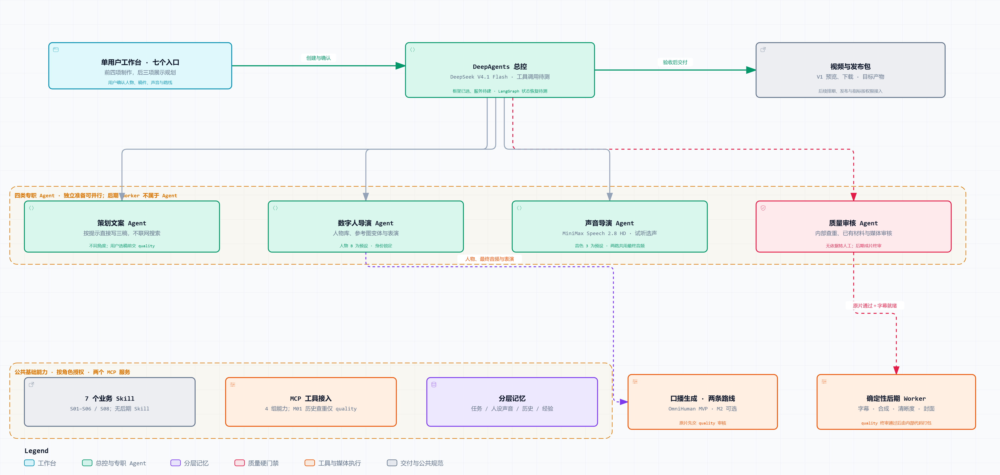

# 总体技术方案：DeepAgents 多智能体视频生产

版本：v2.4；日期：2026-09-23。本文是当前架构的唯一主方案。**本版调整为提示词直接写稿、四类子智能体和代码后期。production/ 已有工程代码；本轮同步了角色/工具注册、运行 Skill 与内部后期入口，但真实后期处理和完整生产链路仍未验收。**

[打开可交互架构图](../架构图/DeepAgents多智能体架构.html) · [输入输出速查](08-端到端技术流程与模型选型地图.md) · [准确模型与接入渠道](09-模型选型决策与接入方案.md)

## 1. 一分钟理解方案

首版是单用户数字人口播工作台。用户新建一条作品，选择或创建人物，输入“生成一期关于 RAG 的 AI 科普视频”，依次确认稿件、MiniMax TTS 音频和口播路线，预览并下载合格视频及投稿材料。DeepAgents 总控分派策划、审核、数字人、声音任务，业务服务直接调度后期代码；独立准备工作并行，有依赖的任务等待上游质量通过及用户选择。后台任务持久执行，关闭浏览器不取消已提交作业。

- **主框架：** DeepAgents；使用其基于 LangGraph 的运行机制承载状态与人工中断，持久化后端仍须配置和验证。
- **组织方式：** 1 个总控＋4 类专业智能体：策划文案、质量审核、数字人导演、声音导演。每个角色有独立指令、Skill、工具权限和任务上下文，不必使用不同的基础模型。
- **文案入口：** 用户提示词直接生成三稿，不搜索或抓取网页；质量审核保留内部历史查重。
- **代码后期：** 后期智能体、字幕剪辑 Skill 和后期/打包 MCP 从目标设计移除，业务服务直接调度程序处理视频、字幕、清晰度和交付。
- **人物与声音库：** 人物 B＋MiniMax 音色 3 是初始预设，用户可创建其他角色并试听选声。两条口播路线共用已选身份、声音和最终音频；换衣景不能换人，Agent 不自行更换人物或声音。
- **MVP 云端路线：** OmniHuman 1.5 接收固定人物图、已审已确认的最终 TTS，以及可编辑身体/表情描述，直接生成身体动作、表情与嘴型随该音频配合的口播视频。不需要 LivePortrait 动作底片或另做 MuseTalk 对口型。身体能否自然运动必须实测；OmniHuman 必须在 MVP 验收，不能延期或用 M2 通过代替。
- **保留低成本 M2：** LivePortrait 制作动作底片，结合相同已确认 TTS 交给 MuseTalk 1.5。TTS 页面是两路共同前置，两路都在第 4 页视频合成执行。Grok 原生有声方案退出当前 MVP，历史调查保留；用户允许固定人物＋外部音频驱动的视频 API，不以随机人物或独立视频生成替代口播。
- **目标产能与交付：** 每天 5 条、每条约 60 秒；1080×1920、9:16、MP4/H.264/AAC。上述是验收目标，尚无生产达标结论。
- **七入口与交付：** 人物形象、口播稿生成、TTS 语音、视频合成、发布、指标监控、领域模型选择始终展示。V1 前四项形成真实制作与下载闭环；后三项展示实际规划/开发状态。排期提醒、人工回填、平台发布/指标和通用模型配置后续分别验收，基础服务端配置及错误反馈属于 V1。

## 2. 架构分层

| 层 | 负责什么 | 不能代替什么 |
|---|---|---|
| 工作台与 API | 七入口、作品与候选管理、试听/预览、确认与下载 | 不在网页请求中等待完整推理；未实现按钮禁用，不伪造进度或平台数据 |
| DeepAgents 协作层 | 总控＋四类角色，直接写稿、审核、人物与声音决策 | 不运行联网检索，不承担逐步后期编排 |
| 业务执行层 | 验证依赖、版本、预算、持久作业、质检和恢复；直接触发后期代码 | 不依赖后期 Agent/MCP 触发；不允许跳过必要阶段 |
| Skill／MCP／记忆层 | 工作规范、能力入口、任务与长期知识 | MCP 不提供模型本身；记忆文本不是资产或账单真相源 |
| Provider 与 Worker | 调用文本/图像/TTS/音频驱动口播 API、可选 GPU 推理、字幕与媒体处理 | Worker 不负责自主改变人物或选择其他付费服务 |
| 数据与媒体层 | 保存业务记录、检查点、内容索引、不可变素材及证据 | 不把 MP4/WAV 放进 Agent 消息或检查点 |

一个 `Work` 是一条作品的根，连接人物、候选稿件、音频、视频、任务及历史版本。用户选择用 `SelectionRequest/SelectionDecision` 保存，质量审批用 `ReviewDecision` 保存；两者都绑定对象版本与摘要，不能互相代替。状态和字段只由 04 定义。前端按同一作品跳转七个页面，未开放页可进入查看用途和计划；首版不做多人注册、租户和多人协作。

主编排面向 DeepAgents 开发。LangGraph 是它的底层运行机制；如需封装固定媒体子流程，可使用受控工具或子图，但不再维护一套与总控竞争的顶层流程。

## 3. 智能体分工与交接

| 角色 | 输入与职责 | 交付物 |
|---|---|---|
| 总控智能体 `supervisor` | 接收主题、时长、预算、角色；按依赖委派，安排返工并汇总 | 任务计划、各阶段引用、最终交付说明 |
| 策划文案智能体 `content` | 根据用户提示词、关键词、时长、风格和可选自供材料直接写三稿；按审核意见修改 | 三种切入角度、版本化稿件、标题/简介/标签、表演意图、自供材料引用和待核断言 |
| 质量审核智能体 `quality` | 在每个阶段读取实际产物和检测结果；事实、重复、声音、画面及成片审核 | 绑定输入版本的审核报告、问题定位与返工建议 |
| 数字人导演智能体 `avatar` | 提供人物候选、衣景和动作说明；最终音频确认后组织 OmniHuman 图音驱动，或 M2 底片与嘴型 | 人物画面、表演说明、按路线生成的口播原片及来源链 |
| 声音导演智能体 `audio` | 在所选 MiniMax 音色内控制情绪、停顿、重音、语速；合成并审核配音，检查成片是否保持该声音 | 最终朗读文本、待用户确认的 TTS、音频报告、实际时长与分段时间 |

Postprocess Worker 是程序执行器，接收经过校验的素材和配置；以 StageExecution.executor_kind=worker、worker_kind=postprocess 记录，不属于 AgentRole，也不返回 AgentResult。质量角色仍独立审核成片，不能把后期改个名字继续交给 LLM。

角色类型固定，任务实例可以有多个。总控只读专业产物并提出下一步，业务执行层按 [接口契约](04-接口契约与数据字典.md) 接受或拒绝工具调用。质量审核独立于生成角色；总控没有“忽略失败直接发布”的工具。

## 4. 一期视频如何生产与并行

1. **建作品与选人：** 登记主题、受众、时长与预算，引用已选人物；新建形象先经生成、审核与用户确认。
2. **策划三稿：** 用户提示词、关键词、受众、时长与可选材料直接交给 DeepSeek，按三种不同切入角度写稿和投稿文案；不联网搜索或抓取，不以同义改写充数。
3. **审核与选稿：** 质量角色查询内部历史，检查重复、错字、逻辑、通俗性、开头和完整性。事实/时效依据用户材料、已审知识或人工核验；无依据的关键断言标待复核。合格候选供用户选择或编辑，编辑后重审；不足三稿明确显示并有限补写。
4. **并行准备：** 用户短句试听选声，声音导演以已选稿件合成全文 MiniMax TTS；数字人导演准备衣景、身体/表情要求及可选 M2 动作参考；页面选项和版本化配置确定字幕样式、封面模板与输出参数，不由后期 Agent 制定方案。
5. **确认音频与生成条件：** TTS 质检通过并经用户试听确认后冻结音轨与实际时长。用户选择 OmniHuman 或 M2，核对人物、表演计划、供应商能力和预算；显示时长、分辨率、估价与重做风险，未确认最终音频不能提交任一路线的口播任务。
6. **按路线生成：** OmniHuman 接收人物图＋最终音频＋可编辑表演描述，直接生成音频驱动口播；M2 使用 LivePortrait 底片＋同一最终 TTS 交给 MuseTalk。需要长片分段时，按句切分同一条已确认 TTS 并保存连续时间映射，不能各段改声或重写正文。
7. **原片审核、字幕与代码后期：** 业务服务触发 Worker 按已确认 TTS 识别/对齐字幕，可与两路口播生成并行。原片审核身份、身体动作、表情、嘴型、段间连续和输出音轨保持；不得用另配声音掩盖云输出音轨不符。合格原片与已审字幕汇合后，由代码执行竖屏后期。
8. **终审与下载：** 检查最终文件、音画同步、字幕与版本引用，用户预览并下载合格成片、封面、投稿资料和 AI 标识。V1 不自动发布；平台能力后续独立验收。

逻辑并行不等于 GPU 并行。一张 GPU 的重型推理先采用队列互斥；提示词写稿、API 配音、CPU 媒体处理可在各自资源额度内并行。不能因为某个子 Agent 提前结束，就使用另一个分支的旧版本产物。

### 4.1 代码后期的固定执行流程

1. 确认最终音频后，业务事件创建字幕作业：读取音频、稿件与朗读映射，由 ASR/强制对齐模块取得真实时间边界，生成 SRT/ASS；模型仍待选型，代码调用模型不等于新增 Agent。
2. 用户在页面选择字幕样式、封面模板、片头片尾和输出预设；后期代码校验配置，不让大模型生成 shell 或任意滤镜表达式。
3. 原片审核通过、字幕就绪且输入版本一致后，Worker 用 FFmpeg 合并分段、裁剪首尾、处理音量、统一帧率/尺寸，按配置去噪和适度锐化，并以 libass 渲染字幕。原片声音不符先退回，不靠替换声音掩盖失败。
4. 清晰度默认使用可重复的缩放/去噪/锐化配置；真实超分模型尚未选定，如需接入须独立验证身份细节和耗时。1080P 尺寸不等于原生细节提升，严重黑帧、模糊或伪影先失败定位，不盲目删帧破坏同步。
5. FFprobe/完整解码产生技术检测，质量角色审核实际交付文件；通过后业务服务自动冻结发布包、清单与文件摘要，开放预览下载。失败按原因重跑内部阶段，无后期 LLM 或打包 MCP 调用。

代码作业复用版本、租约、幂等、预算和恢复机制；用户改稿、改音频使字幕/视频/成片失效，改字幕样式只重渲染。应用重启可依据账本恢复后期进度。

## 5. 内容新意与共同表演说明

策划以年轻受众的具体情境选角度，例如“为什么 AI 读了你的文件仍答错”比泛泛介绍 RAG 更容易形成明确问题。每个候选记录受众问题、核心收益、开头、独特案例、自供材料引用与待核断言，质量审核补充与历史内容的差异判断。主题相同并不必然重复；只换标题、措辞而重复观点和案例应被识别。

审核同时看内容正确性和表达质量。当前内容流程不进行网络搜索/抓取，质量角色也不另开搜索旁路；模型知识和模型自审不构成独立事实证据。关键事实、时效、价格、版本或性能数字缺乏可核依据时转待复核，用户补材料、人工核验或改写删去断言后重审，不虚构来源。事实证据是硬条件；吸引力属于可解释的编辑评价，不能承诺流量。真实完播、互动等运营数据经合法取得并标明样本窗口后进入反馈，不伪造表现，不把一次高播放当普遍规律。

**交付责任在出稿方，不在用户。** 生成三稿后先按门禁自检（确定性规则），未过的硬门禁与可判定的软缺陷（最长句过长、与目标时长偏差过大）由**模型自己**按检查结论重写，断言清单从改后正文重抽、verdict 仍按资料复算，上限两轮；仍不过的稿子如实标为不可采用并计入缺额说明，不伪报通过、不降低门禁。用户看到的是"几个能采用的候选 + 如实的缺口说明"，只需选定一稿；手工改字是备选出路而非常规路径。用户资料是可空的事实依据来源（可带条数、哈希与加入时间），留空时生成侧必须避开需要外部依据的事实断言。为避免"清空断言清单即绕过事实门禁"，正文里字面可识别的事实性表述（数字带量纲、年份、归因词、型号）必须被断言清单覆盖，这是确定性检查、不看模型自述；该检查只覆盖字面可识别的表述，纯叙述性断言是否列全仍由断言清单负责，不声称已穷尽。

策划、声音、数字人角色与后期代码共用 **PerformancePlan（分段表演说明）**：`segment_id`、朗读文本、情绪意图、语速、停顿、重音、动作意图与引用版本。策划给意图，声音/数字人提出可实现的参数，业务层合并并冻结；情绪未被所选视频模型、TTS 或动作素材支持时记录缺口，不能静默假装支持。正式字段见 04，本文不另建 schema。

两路实际分段时间都从已确认 TTS 测得，不能提前按字数编造。改稿或改音色/语速/情绪使音频、口播和字幕依赖失效；只改衣景/动作可复用未变化且仍获准的 TTS，但重做对应口播并重新检查声音保持与同步。只改字幕样式只重渲染及终审。失效沿真实依赖传播。

## 6. 固定人物、声音与两条路线边界

初始人物身份 `av_base_b_v1`，声音资产 `voice_minimax_warm_bestie_v1`，实际音色 ID 为 `Chinese (Mandarin)_Warm_Bestie`；材料见 [固定主播目录](../../assets/固定主播/主播B/版本1/角色档案.json)。人物 B 与音色 3 已由用户选择，OmniHuman 与 M2 共用这些版本，不另建原生视频声音选择流程。

新人物创建接受性别、年龄、发型、外貌、气质等结构化关键词与自由补充，编译为可预览的提示词。选定后保存参考图和不可变身份版本；衣景请求只能改变允许的服装/背景描述，不能仅靠固定提示词保证同一人。

日常生产复用已审资产，不每期重新生成脸或声音。人物 B 原图为 941×1672，并非原生 1080P；后处理输出 1080×1920 不等于源图细节真实增加。换装换背景使用人物参考和受控编辑，再做身份审核；GPT Image 2 参考编辑尚未验收。

LivePortrait 从动作参考迁移眼睑、表情和头姿，**不会根据 TTS 自动设计任意表演**；MuseTalk 使用实际音频生成嘴型。数字人导演负责选择、安排和核对动作素材，不能用 Agent 提示词取代缺失的动作控制能力。当前肩膀/躯干仍基本固定。

EXP-001 已有 15.20 秒 M2 样片，两阶段作业 235.177 秒；按 1.58 元/小时估算约 0.103217 元，仅是该短片 GPU 作业估算，不是账单、完整成本或 60 秒成本。约 9.13 秒循环动作参考只用于实验，正式动作母版、长片接缝和商用权重许可仍须验收。证据见 [M2 实测](../selection/01-数字人口播/06-人物B表情动作改善实测.md)。

OmniHuman 1.5 是 MVP 必交付的音频驱动口播 Provider，使用火山视觉接口 `req_key=jimeng_realman_avatar_picture_omni_v15`。输入固定人物图和已确认 MiniMax TTS，可附经接口验证的身体/表情描述；无需 LivePortrait 或 MuseTalk。自由提示不能保证任意肢体动作，先测试小幅手势、肩部/躯干与表情的自然配合；需要展示手部时使用同一身份的半身含手构图，并重新检查身份和手部质量。

TH-COMP-003 历史火山片长 9.48 秒、输入音频长 9.36 秒；按 24 kHz 单声道核对，最佳时间偏移为 0 ms、波形相关系数 0.99996223。它支持该样本音轨保持判断，不证明当前人物 B、身体动作、嘴型自然度或约 60 秒作品通过。声音保持必须在本次人物与参数上重验，不能仅凭“带音频输入”放行。

旧规格为输入音频少于 60 秒、建议不超过 15 秒。实施前核对 OmniHuman 当期限制；约 60 秒作品按语句切分同一条已确认 TTS，保存每段起止、映射和音轨摘要，检验拼接后语音/动作/人物连续及音画同步。

用户已确认 OmniHuman 为 1 元/生成秒（100 分/秒）：60 秒视频费估算 60 元，每天 5 条约 300 元，30 天约 9000 元。实际账单和分段取整未核验；TTS、图片/文本、失败返工及存储另计。报价确认不等于调用预算授权，提交须有适用预算。M2 保留低成本对照，不把其短片估算当作长期生产单价。

## 7. 全环节质量门禁

| 门禁 | 最少检查内容 | 不通过时 |
|---|---|---|
| 内容 | 历史主题/观点/片段、来源与时间、事实、**断言清单是否覆盖正文里的事实性表述**、逻辑、口语、开头和完整性 | 定位到段落与断言，**由出稿方（模型）有限重写**或人工复核；仍不过则明确标为不可采用 |
| 人物与动作资产 | 同一身份、服装背景正确、动作要求能力匹配；M2 另查动作来源、参考覆盖和衔接 | 禁止提交口播，重新选择或修正资产 |
| 音频 | 已选固定音色、ASR 稿件核对、术语/数字、普通话、情绪、削波、静音、实际时长 | 修正朗读并重做受影响 TTS，重新质检/确认，失效传播到两路口播和字幕 |
| 口播原片 | 嘴型、人物身份、身体动作、表情、段间衔接、伪影、同步/解码；OmniHuman 输出音轨对已确认 TTS 的内容/声音/时间保持 | 退回所选路线；不自动换模型或加 MuseTalk 修补，不用换声掩盖音轨不符 |
| 最终成片 | 编码/尺寸/帧率、字幕内容与时间、响度、黑帧、封面文案、AI 标识 | 修正时间线/字幕/输出，重新终审 |

质量 Agent 汇总事实和检测结果；FFprobe/FFmpeg 等提供确定性指标，视觉/声音模型和人工复核提供感知证据。**纯文本模型不能仅看任务日志判断脸是否漂移、嘴型是否同步。** 身份模型、视觉审核模型、ASR/对齐与阈值尚待选型；缺检测能力时进入人工复核，不能按通过处理。

初稿后最多自动重写 3 次，且受剩余预算约束；其他媒体返工次数逐工具配置。所有报告绑定实际稿件或资产版本、检测器版本、证据和问题时间码。具体门槛与取样法只在 [验收方案](06-验收标准与测试方案.md) 定义。评估采用固定输入对照、独立人工盲评和故障注入；内容新意、身份/声音、口型/字幕、Agent/Skill、MCP/记忆、审核可靠性与生产成本分别计量。指标分母、采样、目标类型及报告要求统一见其第4章；硬失败不能被综合评分抵消。

## 8. Skill、MCP 和记忆层

### 8.1 Skill：可版本化的制作规范

保留 7 个 Skill：S01 选题与新意、S02 口播写作、S03 事实与重复审核、S04 固定人物与衣景、S05 动作表情匹配、S06 固定声音与情绪、S08 分阶段媒体质量验收。删除 S07 字幕与剪辑；保留编号以便历史追溯。S01/S02 不含联网步骤；后期代码不加载 Skill。每份包含适用条件、输入、步骤、允许工具、输出要求、失败处理与例子。运行记录固定 Skill 版本；待改进经验不能直接改正在执行的规范。提示词规定工作方法，强制权限、预算和质检仍由代码执行。

### 8.2 MCP：Agent 的受控工具入口

采用 `langchain-mcp-adapters` 接入 4 组 MCP：M01 历史内容查重（仅质量角色）、M02 角色与记忆、M03 媒体生产、M04 质量检测。推荐仍为 studio-core / studio-media 两个服务，具体工具以 10 为准。移除 search_sources、fetch_source、draft_edit_plan、align_subtitles、render_video、build_publish_package 的 Agent/MCP 暴露及 M05 能力组。后期路径为业务事件 → 内部作业表 → Postprocess Worker，不经过 MCP；相应内部函数与任务记录仍保留。

工具接收资产 ID、结构化参数和幂等键，返回任务 ID、状态或产物引用。长推理分提交、查询、登记；Agent 不拿生产密钥，不执行任意 shell，不直接写正式资产和发布状态。已有本地纯函数可用普通工具，跨进程/远程能力再经 MCP 暴露，不为每个 Python 函数单独建服务器。

### 8.3 记忆：分清四类数据

- **单次任务：** 消息、委派、修订和等待状态由持久 checkpointer 承载，以任务/执行隔离。内存型示例不能满足重启恢复。
- **固定人设：** 角色、声音、风格和允许动作存入版本化资产/配置库，Agent 只读引用，不能通过写记忆更换主播。
- **内容历史：** 稿件、主题、观点、案例、来源和发布时间存数据库并建立检索索引，包含已通过但未发布稿件。
- **运营经验：** 审核修正、术语读法、用户偏好和真实反馈经审核形成长期记忆，带来源、适用范围、时间和失效条件。

采用 DeepAgents 的分层 backend / Store 接口承载可读写记忆，持久数据库具体适配待测。子 Agent 写独立工作区并提交候选，总控经业务服务审核合并，使用期望版本防并发覆盖。模型、embedding 与索引版本分别登记；媒体文件、账单、审批仍以业务库和资产库为准。

## 9. 技术选型与部署边界

| 层面 | 当前选择或建议 | 证据状态 |
|---|---|---|
| Agent 框架 | **DeepAgents（用户已选）**；LangGraph runtime 为底层 | 四角色和工具边界已有代码调整；内部后期缺能力时明确阻断，真实模型兼容与成片另验 |
| Agent 决策/写稿 | DeepSeek 官方 `deepseek-flash`，用户目标 V4.1 Flash | 用户已选；本项目未真实调用，不假定视觉输入或任意结构化功能可用 |
| 图片 | 专用中转 `gpt-image-2` | 已生成并选择人物 B；参考编辑待验 |
| TTS | MiniMax 官方 `speech-2.8-hd` | 已生成音色 3 样音；情绪、多段拼接和长稿待验 |
| MVP 音频驱动口播 | OmniHuman 1.5：固定人物图＋最终 MiniMax TTS＋身体/表情描述 | 历史短片及音轨保持证据；人物 B、身体运动、当前音轨保持、嘴型、分段及约 60 秒交付待验 |
| 可选本地路线 | M2：LivePortrait＋已确认 MiniMax TTS→MuseTalk 1.5 | 已有短片实验；不能替代 OmniHuman MVP 验收 |
| API 与契约 | Python＋FastAPI＋Pydantic 为现有工程方向 | production 已有局部实现；本版执行器/角色契约及真实链路需验证 |
| 数据与记忆 | 建议首测 PostgreSQL＋SQLAlchemy；需要向量检索时 pgvector | 需验证业务事务、checkpoint/Store 适配与备份；embedding 另选 |
| Worker 与后续排期 | V1 持久作业表＋独立 Worker；后续 APScheduler 仅唤醒排期 | 建议试验组合，需租约、幂等和恢复测试 |
| 媒体与字幕 | FFmpeg、FFprobe、libass、Pillow；ASR/对齐模型另测 | 部分媒体工具有实验使用，完整生产管线未验收 |
| 工作台 | production 已有 Vue 3＋Vite 骨架；产品正式选型以 02 为准 | 本次不改前端代码；本版角色/代码后期状态展示需回归 |
| 存储与传输 | 本机不可变媒体目录＋云 Worker；按需私有对象存储 | 服务化、传输校验及备份需实测 |

本机承载工作台、控制面与媒体管理；OmniHuman 通过火山云 API 运行，不依赖本项目 GPU Worker。可选 M2 在算力云独立运行 LivePortrait、MuseTalk 环境，不将旧推理依赖强塞进 Agent 服务环境。数据库/MCP 的具体部署主机由工程试验决定，不公开暴露无鉴权服务。

准确型号、渠道和模型内部依赖由 [09 模型接入](09-模型选型决策与接入方案.md) 维护；未决对比只在 [02 技术选型](02-技术选型对比.md) 保留，避免在每篇文档重复列候选。

## 10. 持久执行、成本与恢复

每次专业任务绑定 `task_id`、执行 ID、输入版本、角色/声音版本、Skill/模型版本、预算和产物摘要。总控计划与子 Agent 返回值都必须通过结构化校验；缺产物、版本不符或门禁未过时不能推进。

外部提交前原子预留预算并记录尝试与幂等键；提交后保存远端任务 ID。超时且受理未知时先核对远端，不能通过恢复 Agent 再扣费生成一次。checkpoint 保存对话/执行进度，**不保证外部 API 恰好执行一次**。恢复时同时核对业务作业和资产账本。

生成前显示路线、模型、分辨率、时长、估算费用、估价依据和任务预算；说明效果不满意后重生成可能再次收费。账户价格未确认时不把历史参考价当新报价。按预留、用量和实际账单分别记账；预算内不反复确认，超出上限停止新增提交并等待决定。

成本分开记录 LLM tokens、图片/TTS、云视频 API、GPU 启停/推理/空闲、存储和人工；按路线报告每个合格包成本，失败返工计入。取消停止新提交，已受理作业继续核对，不承诺取消即退款。模型/供应商、声音、人物和路线只允许用户显式变更，OmniHuman 失败不自动切换其他模型或使用 MuseTalk 修补；未知任务状态先对账，再在适用授权和次数上限内重做。

进度来自任务事件：排队、写稿、历史查重、生成、审核、代码后期、等待选择、完成或失败。只有获得真实进度或明确标注的估算依据才显示比例；否则展示阶段与已等待时间。刷新页面从业务库恢复，晚到的旧版本结果保留历史但不覆盖新选择。

## 11. 发布输出

交付包至少含成片、字幕、封面、标题/简介/标签、AI 声明、资产摘要、质量报告与来源清单。全部来自同一有效任务版本。PublishAdapter 独立于 Agent，读取已冻结包并核对账号能力。

V1 到可下载发布就绪包结束，发布页、指标监控页、领域模型选择页展示真实规划/开发状态，未实现操作禁用。排期提醒和人工回填属于后续增量；人工报告发布与平台确认发布仍区分。抖音、B站、快手、小红书、微信视频号分别核对账号、官方接口、数据权限与 AI 标识能力，不以网页模拟补齐缺失接口。指标未取得显示不可获取，不填 0。领域模型选择后续支持已适配供应商的 URL、密钥、模型名称和能力检查；V1 已须具备服务端配置、连接检查和脱敏错误反馈。业务状态与字段以 04 为准。

## 12. 开发与验证顺序

1. 先验证作品/选择契约、七入口与占位状态、真实阶段进度，再用模拟模型/工具验证 DeepAgents 委派、并行依赖、审核退回、持久恢复、记忆隔离和重复提交防护；不调用收费生成服务。
2. 在另有预算的前提下，验证实际 DeepSeek 的工具调用、多轮协作与恢复兼容；框架演示不代表真实模型兼容。
3. 接入人物库、三稿选择、MiniMax 试听/最终音频确认与 OmniHuman MVP；先以人物 B＋已确认音频测试短片身体运动、表情、嘴型和音轨保持，再验证约 60 秒分段连续、成本和日产量。保留低成本 M2，不用其通过替代 OmniHuman MVP。
4. 分别选定查重、字幕对齐、影像/声音检测与数据栈，贯通终审和 V1 发布包。
5. 验证每天 5 条的实际吞吐、失败恢复、合格成本及备份；官方发布另行准入。

具体任务和退出条件见 [05 实施计划](05-开发实施计划.md)，验收项目见 [06 验收方案](06-验收标准与测试方案.md)。各步数据对象、存储位置、并行汇合与修改失效见 [08 端到端数据流](08-端到端技术流程与模型选型地图.md)，另有 [交互数据流图](../架构图/作品生产数据流.html) 和 [评估方案与指标总表](../阅读器/评估指标总表.html)。以上是当前目标契约；既有 production/ 代码的本版迁移和真实模型/媒体验收需逐项核对，不把文档改版视为功能完成。

## 13. 文档与历史

本轮原件见 [单用户工作台方案确认前备份](../历史版本/2026-09-22-165025-单用户工作台方案确认前/工作台方案确认前开发文档.zip)。

本文讲完整架构；04 定义契约，05 安排实施，06 定义验收及唯一指标基线，09 维护准确模型，10 展开 DeepAgents、Skill、MCP 和记忆实现边界。08 展开输入输出、数据存储、交接门禁及返工依赖，不另立架构或数据契约。

本轮原件包作为历史基线保留，不能覆盖本版决定。调研和付费实验原件不改写；`demo` 及其素材、代码和结论不读取、不借鉴。
