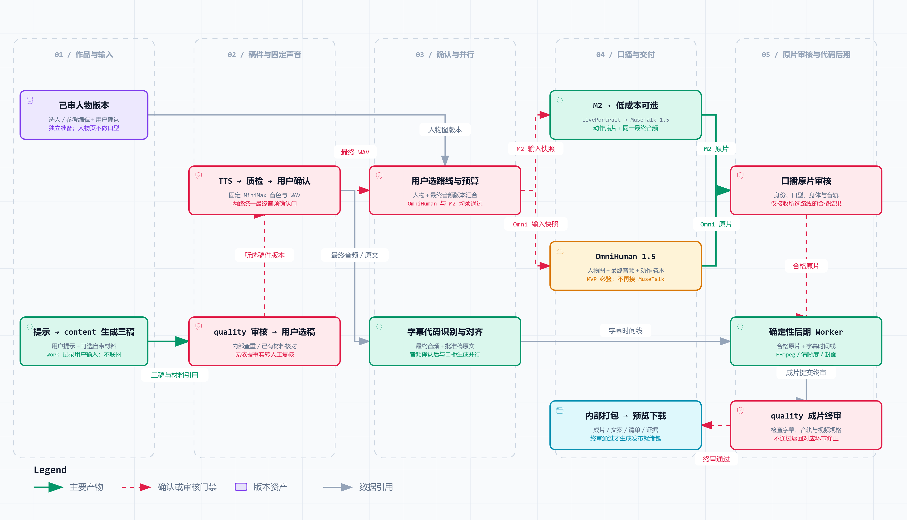

# 端到端数据流与技术流程

版本：v2.4；日期：2026-09-23。本文说明数据从哪里来、经过哪些处理、保存在哪里、何时交给下一环节，以及修改后重跑哪些步骤。架构以 [03 总体技术方案](03-总体技术方案.md) 为准，字段及状态以 [04 数据契约](04-接口契约与数据字典.md) 为准，指标及基线只由 [06 评估方案](06-验收标准与测试方案.md#42-指标总表) 维护。

快速阅读：[项目方案汇报](../汇报/项目方案汇报.html) · [交互式数据流图](../架构图/作品生产数据流.html) · [评估方案与指标总表](../阅读器/评估指标总表.html)。图和本文描述 v2.4 目标契约；production 已存在真实实现，本轮已同步角色/工具注册及内部后期入口，真实媒体与全部契约实现仍须验收。

## 1. 输入与最终输出

首版面向用户本人使用。输入例如“生成一期关于 RAG 的 AI 科普视频”，选择受众、内容类型、时长、人物与预算。系统提供候选，用户依次确认人物、稿件、音色与最终 TTS，再选择视频路线。OmniHuman 和 M2 都使用同一已确认音频进行口播；声音、身体、表情和嘴型合格后才进入交付。

V1 输出：可预览和下载的 1080×1920 竖屏 MP4、字幕、封面、标题、简介、标签、AI 声明、质量报告和文件清单。排期提醒、人工回填、按平台授权的发布和指标监控属于后续增量。

前端固定显示七个入口：人物形象、口播稿生成、TTS 语音、视频合成、发布、指标监控、领域模型选择。前四项形成真实闭环；后三项可进入查看实际规划/开发状态，未实现按钮禁用。基础服务端配置、连接检查与脱敏报错属于 V1，完整通用模型设置后续开放。

当前目标为 1 总控＋4 专家 content、quality、avatar、audio；7 个业务 Skill 保留 S01-S06、S08，不重编号。MCP 为 M01 本地内容查重、M02 角色与记忆、M03 媒体生产、M04 媒体检测与审核，仍部署 studio-core/studio-media 两服务。代码 Worker 按依赖自动做后期；现有短片和 production 实现不能代替本版代码迁移与端到端验收。

## 2. 首次资产准备

人物 B＋MiniMax 音色 3 为初始预设，OmniHuman 与 M2 共用该人物/声音版本；用户也可新建人物并试听选声。首次生图接收性别、年龄、外貌、发型、气质等关键词和自由描述，GPT Image 2 生成候选，经审核和用户选择后登记固定身份。后续衣景变化必须参考该人物图编辑并检查身份，重复同一提示词不能保证同一个人。

人物页面收集身体动作、表情和自由描述；真正的音频驱动口播在第 4 页视频合成执行。OmniHuman MVP 使用人物图＋用户确认最终 TTS＋可编辑表演描述；可选 M2 使用动作底片＋同一音频对口型。需要手部时采用同身份半身含手构图并质检，不能为动作要求换人。自由描述按实测能力执行，不承诺任意肢体动作。

## 3. 一期视频的输入输出

图中箭头表示数据依赖。人物准备可与按提示词直接写稿并行；TTS 依赖已审已选稿件。两条视频路线均等待最终 TTS 质检和用户确认，字幕按同一音轨对齐并可与视频推理并行。所有分支在同一作品和输入版本上汇合。

| 步骤 | 输入 | 负责人及技术 | 输出 |
|---|---|---|---|
| 1 建作品、选人物 | 主题、内容类型、时长、人物候选、预算 | 工作台＋总控＋业务服务；DeepAgents | Work、人物选择、版本与任务计划 |
| 2 输入与资料整理 | 提示词、关键词、受众、目标时长、用户提供或已有已核资料 | 业务服务登记输入；content 接收摘要 | 输入版本、用户资料引用与待复核要求；不搜索或爬取外网 |
| 3 三种角度写稿 | 提示词、关键词、时长和用户资料 | content；DeepSeek＋写作 Skill | 直接生成三个不同角度候选、资料说明、标题/简介/标签和表演说明 |
| 4 审核与用户选稿 | 候选、来源、历史命中 | 质量审核＋工作台用户选择 | 逐稿报告、已选稿件版本；编辑后重新审核 |
| 5A TTS 声音制作 | 已选稿、短句试听、所选音色与表演意图 | 声音导演；MiniMax speech-2.8-hd | 全文 WAV、朗读映射和实际时长；音频报告通过并由用户确认后冻结 |
| 5B 人物与表演准备 | 所选人物、衣景与身体/表情要求 | 数字人导演；资产库、GPT Image 2 编辑 | 已审人物画面及表演说明；M2 另准备动作参考 |
| 6 核对生成路线 | 人物图、已确认 TTS、动作要求、能力/报价 | 用户＋业务门禁 | OmniHuman 1.5（MVP 必交付）或 M2（低成本本地可选）的选择与适用预算 |
| 7A OmniHuman 音频驱动 | 固定人物图＋已确认 TTS＋可编辑身体/表情描述 | 数字人导演；OmniHuman 1.5 API | 按输入音频驱动身体、表情和嘴型的口播原片；不经过 LivePortrait/MuseTalk |
| 7B 可选本地口播 | 人物图、批准动作参考、同一已确认 TTS | 数字人导演；LivePortrait → MuseTalk 1.5 | 合格动作底片、数字人口播原片 |
| 8 原片审核 | 原片、参考人物、已确认音频与表演要求 | 质量审核；媒体检测/人工 | 身份、身体动作、表情、嘴型及输出音轨保持报告；云路线不得擅自换声 |
| 9 字幕与后期 | 同一已确认 TTS、合格原片、用户样式与输出规格 | 业务依赖自动触发确定性 Worker；内部 ASR/对齐、FFmpeg＋libass、FFprobe、清晰度处理和封面代码 | 同源时间轴字幕、封面和目标规格成片；不要求 Agent 剪辑计划 |
| 10 最终审核 | 成片和有效版本证据 | 质量审核＋程序门禁 | 最终音画同步、字幕/技术质量及问题时间码 |
| 11 预览、下载 | 已通过产物与投稿文案 | 工作台＋业务服务 | 可下载成片和冻结发布就绪包；发布未执行 |

5A/5B 按依赖并行；字幕/封面样式由用户设置和代码模板给出；7A/7B 每次只执行用户选定的一条。TTS 确认是两路共同前置，字幕对齐可与口播推理并行。OmniHuman 当前身体运动、人物 B、音轨保持和嘴型待实测，不能用 M2 通过代验。

旧 OmniHuman 规格为音频少于 60 秒、建议不超过 15 秒，实施前核对当期限制。约 60 秒需要时按语句切分同一最终 TTS，保存统一音轨时间映射，逐段核对音画并检查拼接连续性。M2 底片也须覆盖确认时长并检查接缝。

## 4. 每次交接具体传什么

下表的 D01～D12 仅是本文的数据流编号，不新增业务阶段或状态。Agent 经 MCP/业务工具接收对象 ID、版本和摘要；大图片、音频和视频保存在媒体库，由 Worker 按授权读取，不把整段媒体塞进 Agent 消息。用户的选择记录、质量报告和费用确认是三个独立条件。

| 数据流 | 输入 → 输出 | 校验与落库 | 下一环节放行条件 |
|---|---|---|---|
| D01 需求进入作品 | 主题、受众、内容类型、时长、关键词 → `Work`、`Task`、分角色 `AgentWorkItem` | 业务库保存作品、任务、依赖图与配置快照；检查点仅保存执行进度及引用 | 必填项和预算策略有效；只校验当前阶段所需输入，未生成的音频允许为空 |
| D02 创建或选择人物 | 人物关键词/自由描述，或既有人物 ID → `GenerationIntent`、候选图片、`AvatarIdentity` | 图片保存在媒体库，`SourceRecord` 保存来源；质检通过后记录人物 `SelectionDecision` | 身份、写实画风、来源均通过，且用户明确选择；不生成最终嘴型视频 |
| D03 用户资料与内部查重 | 用户提供或已有已核资料、稿件内容 → 资料引用、quality 的相似稿件命中 | 原资料/日期/摘要留档；quality 仅通过 M01 的 search_content_history 查询本地已通过历史，不搜索或爬取 | 无依据事实/最新信息标待复核，请用户提供依据或人工确认；资料不能修改角色/工具权限，不能假造 URL |
| D04 三稿与选稿 | 提示词、关键词、时长、用户资料 → 3 个 ScriptVersion、各自 QualityReport → 选稿 SelectionDecision | content 由 DeepSeek 直接生成，quality 查重/审核并反馈有限改稿；正文、角度、分段和资料说明分版本保存 | 无依据事实不能凭模型自审通过；不足三稿显示缺额，有限改稿；用户选择合格稿，待复核项先补资料或人工确认 |
| D05 表演与衣景准备 | 已选人物、稿件、音色意向、衣景/动作要求 → `AvatarVariant`、`PerformancePlan` | 以真实参考图编辑衣景；逐段记录情绪、停顿、重音及动作意图；登记支持/近似/不支持项 | 身份和衣景审核通过；声音及动作使用同一表演计划，不能各自改正文 |
| D06 TTS 生成与确认 | 已选稿、选声记录与表演计划 → 全文音频 `MediaAsset`、报告及 `SelectionDecision` | 保存 MiniMax 参数、朗读映射、音频 SHA-256、实际时长与费用；重合成保留旧版本 | 音频质检通过且用户试听确认；此处冻结两条路线共用的最终音轨 |
| D07 按路线生成口播 | OmniHuman：人物图＋最终音频＋表演描述；M2：人物/底片＋同一音频 → `ProviderRun` → 原片 | 提交前预留预算，记录远端 ID、参数和父链；云分段另记录同一 TTS 的起止映射，M2 保存参考/底片 | 第 4 页执行；两路都等待 D06。OmniHuman 不依赖 LivePortrait/MuseTalk；路线、能力、选择与预算有效 |
| D08 字幕时间轴 | D06 已确认最终 TTS、已审正文与朗读映射 → 带时间轴字幕 MediaAsset | 业务依赖触发 Worker 内部 ASR/对齐，保留摘要/工具版本和全片时间映射；不暴露 align_subtitles MCP | 内容、分句和时间轴由 quality 检查；不按字数均分或照抄识别错误，可与 D07 并行 |
| D09 原片与音轨审核 | 原片、人物参考、D06 音频与表演计划 → `QualityReport`、必要的 `ReviewDecision` | 检身份、身体运动、表情、嘴型、段间连续、同步；比对云输出音轨与最终 TTS 的内容、声音和时间 | 硬项全部通过；缺测进入复核。不以重新配音或换声掩盖音轨不符，不因输入带音频就免验 |
| D10 后期与终审 | 合格原片、字幕时间轴、用户样式和封面要求 → 竖屏成片/封面、最终报告 | 依赖满足后代码 Worker 内部 FFmpeg＋libass、FFprobe、清晰度处理和封面生成；保留最终时间线；不暴露 render_video MCP | quality 检查最终编码、字幕、响度、画面、身份和标识；审核交付文件，不只检查原片 |
| D11 预览与下载 | 同一有效版本的成片、字幕、封面、文案和报告 → PublishPackage、manifest | 最终 quality 通过后代码 Worker 生成并登记包，业务库冻结清单、媒体库保存文件及摘要/来源；无 M05 交付 MCP | 所有门禁与选择有效；V1 到 ready 和下载结束，不显示已投稿 |
| D12 审核经验回流 | 真实审核修正、术语读法、用户偏好 → `MemoryCandidate` → 经审经验 | 候选经验隔离保存，经审核才进入长期检索；保留来源、版本与失效条件 | 只读当前有效经验；失败稿不能自动写为已验证事实，模型输出不能自行改人物或预算 |

D05、D06 可在依赖满足后并行；封面/字幕样式由用户配置与代码模板提供；D08 在 D06 确认后与 D07 并行，D10 等待 D08 和 D09。表演计划必要参数先冻结。M2 单 GPU 重型作业以租约排队，OmniHuman 云调用遵守额度和预算，Agent 并行不意味着无限提交。

### 4.1 两条视频路线的数据区别

**MVP OmniHuman 1.5：** `固定 AvatarVariant＋经审核并由用户确认的 MiniMax TTS＋可编辑身体/表情描述 → OmniHuman 1.5 → 音频驱动口播原片 → 身份/身体动作/表情/嘴型/音轨保持审核 → 字幕与后期`。无需先制作动作底片，也不再单独对口型；身体运动自然度必须按当前人物和动作要求实测。

**可选 M2：** `固定 AvatarVariant＋批准动作参考 → LivePortrait 动作底片`；`底片＋相同最终 TTS → MuseTalk 1.5 → 原片审核`。M2 用于低成本本地生产选择，不能代替 OmniHuman MVP 验收。

两路字幕均以已确认 TTS 为源，最终音画、剪辑后字幕映射和云输出声音保持仍要检验。TH-COMP-003 的 9.48 秒历史火山片（输入 9.36 秒）在 24 kHz 单声道对齐下最佳偏移 0 ms、相关系数 0.99996223；该样本音轨保持不代表人物 B、身体运动或嘴型自然度已经通过。

按用户确认的 OmniHuman 1 元/生成秒估算，60 秒视频费约 60 元、5 条/日约 300 元、30 天约 9000 元。账单及分段取整未验证，TTS、图像/文本、失败返工和存储另计；该报价不是实际调用预算授权。

### 4.2 数据存在哪里、由谁写

| 存储范围 | 保存的数据 | 写入者与使用原则 |
|---|---|---|
| 业务库 | Work、Task、版本指针、选择、审批、ProviderRun、预算账本、发布包清单 | 确定性业务服务事务写入；Agent 只能经获准工具提交，不能直接改成功/发布状态 |
| 不可变媒体库 | 人物图、音轨、动作底片、原片、字幕、成片、来源摘录、检测证据 | Provider/Worker 上传后核验字节摘要和大小再登记；`parent_asset_ids` 保留派生链 |
| 任务记忆 | DeepAgents 工作图、消息、子任务引用及等待位置 | 持久 checkpointer；恢复时还须核对业务库和外部作业，不能只恢复对话后重做扣费请求 |
| 人设记忆 | 已批准人物、声音、风格与版本引用 | 资产/配置库为权威，Agent 只读；换人换声由显式选择产生新版本 |
| 历史内容 | 主题、观点、正文、案例、来源与审核/发布事实，及派生检索索引 | 内容通过审核后登记；索引注明 embedding/索引版本，可重建，不覆盖原稿 |
| 经验记忆 | 经审核的纠错、术语、偏好和适用条件 | 子 Agent 提交 MemoryCandidate，总控经业务服务审核合并；过期/越界记录不参与决策 |
| 凭据存储 | Provider 密钥及账户访问凭据 | 服务端独立受控存储；界面、Agent 上下文、进度事件及导出包只出现引用或掩码 |

数据库、对象存储与检索实现仍按技术选型试验确定；上表是逻辑职责，不代表已部署七套独立服务。四类记忆与业务库可共用经过验证的持久化设施，但命名空间、写权限和权威来源必须分清。

### 4.3 一次异步生成怎样返回到前端

1. 工作台提交作品 ID、当前版本、操作参数和幂等键；业务服务校验选择/审批/能力/预算，创建 `StageExecution`、工作项和必要的费用预留，返回任务引用。
2. 总控分派 audio/avatar 通过各自获准 MCP 工具调用 Provider/Worker；外部异步请求先登记 `ProviderRun`，随后查询原远端任务。密钥和临时签名 URL 不进入 Agent 消息或业务事件。
3. 字幕、后期、清晰度、封面和包登记由业务依赖自动触发代码 Worker，总控不写剪辑计划；quality 仍逐阶段及终审。Worker 下载或生成文件，核对完整性和摘要，再登记 `MediaAsset`、输入父链和检测报告。质量 Agent 引用这些证据提出建议；业务门禁决定能否推进。
4. 业务状态与事件在同一事务提交；前端通过增量事件/SSE 和 `ProgressSnapshot` 展示真实阶段。无真实比例时 `percent=null`，显示排队或已等待时间；断线后按 `seq` 恢复。
5. 分支汇合再次比对作品、输入摘要、资产和选择版本。晚到的旧任务结果保留作历史，不能覆盖新作品指针。

外部受理未知时标记相应 Provider 作业 `unknown`，阻断新的计费提交并核对原任务；取消后也继续登记已受理作业的结果与账单。重试不能简单等于再次调用 API。

## 5. 修改后哪些数据失效

失效指不再用于当前作品的生产和审批，旧文件、账本与证据保留。准确依赖规则以 04 第 3.4 节为准。

| 用户修改 | 可复用 | 必须重新生成或审核 |
|---|---|---|
| 当前已选口播正文 | 身份及无关衣景资产 | 表演计划、TTS 及确认、两路相关口播、字幕/投稿文案、成片与包；未选候选修改不影响已选正文 |
| MiniMax 音色、语速或情绪 | 未变稿件、身份及衣景 | TTS、音频审核/确认、两路相关口播、字幕对齐和成片；M2 底片重新检查时长覆盖 |
| 人物或衣服背景 | 未变化且仍获准的稿件与最终 TTS | 新人物/变体审核、身份绑定、口播和后期；M2 重做适用底片；两路重新检查音轨保持与同步 |
| 生成路线或身体/表情动作 | 未变稿件、身份及声音要求未变的最终 TTS | 核对路线、能力和预算；重做对应口播及音画审核/成片；动作若联动改变节奏则重新确认音频 |
| 只改字幕字体、颜色或位置 | 已确认 TTS、口播原片、已校准时间轴 | 字幕渲染、成片终审和包 |
| 剪辑节奏、裁剪或片头 | 未改变内容的源音轨与源原片 | 剪辑时间线、字幕映射、音画同步、成片终审和包 |

## 6. 各环节如何进入评估

完整的指标含义、计算方法、标准基线和 ★ 技术核心标记见 [一张评估总表](../阅读器/评估指标总表.html)。首版汇报只看其中 11 项核心指标；本节只给数据流与评估的对应关系，不复制阈值。

- **D01 任务与所有交接：** E01、E20～E23，检查契约、Agent/Skill 执行、MCP 副作用及记忆；用户选择与依赖顺序另按 AC-UI 验收。
- **D03～D04 内容：** E02～E06，逐候选检验新意、开头、事实、重复和口语；三稿都保留报告，选中稿必须合格。
- **D02/D05 人物与动作：** E10～E12，固定身份与衣景对照，检查表演要求和最终实际观感。
- **D06/D09 声音：** E07～E09；先审核 MiniMax TTS 并经用户确认，D09 再核对两路视频声音保持。OmniHuman 不得未经批准换声或更改朗读内容。
- **D07/D09 口播：** E12～E15；E13 按路线查真实来源链：OmniHuman 人物/最终 TTS/表演说明→原片，M2 底片/最终 TTS→MuseTalk 原片。身体运动、嘴型与音轨保持按 06 验收，M2 不能代验 OmniHuman。
- **D08/D10 字幕与成片：** E15～E18；最终交付文件重新检测，不直接继承原片通过结论。
- **全程审核与 D11 交付：** E19、E24～E28，统计漏放/误拒、包完整、交付率、产能、成本和总耗时。失败、返工及等待均保留记录。
- **后续平台与模型页面：** F01～F03 分别检查发布真实性、运营数据准确性和完整模型配置能力；不计入 V1 生产完成率。V1 的基础配置由 E01 检查，后三页可进入及禁用行为由 AC-UI-01 检查。

未实现工具或没有足够证据的测项标记 `NOT_RUN/BLOCKED`，不填写虚构分数。模型/参数对照固定其余输入，选择哪条路线由质量门禁和合格交付成本共同决定，不能以生成成功代替质量通过。

M01 仅 quality 可调用 search_content_history，无 search_sources/fetch_source；删除 S07 字幕与剪辑 Skill、M05 交付 MCP，M04 不含 align_subtitles/render_video。字幕对齐、FFmpeg＋libass、FFprobe、清晰度、封面和包登记都属于确定性 Worker 内部，不进入 Agent/MCP 暴露面。

## 7. 哪些技术还没有选定

- **查重：** BGE-M3 / text-embedding-v4 等待同语料比较；重排器按效果需要单独验证。
- **字幕与稿件核对：** 两路均按最终 MiniMax TTS 做 ASR/对齐，并核验原生时间信息；最终视频还须检查声音保持。FunASR/paraformer-zh 与 faster-whisper/whisper-large-v3 是候选，不混同 MuseTalk 内部 Whisper 音频特征模型。
- **声音/画面审核：** 声纹、身份检测、视听质量模型及阈值待选；纯文本 DeepSeek 不承担未经验证的视觉能力。
- **工程栈：** 以 02 的当前候选为准；DeepAgents 已选，数据库、前端和队列不因此自动选定。

具体比较方法见 [07 实测流程](07-技术选型与实测流程.md)。

## 8. 失败处置与后续平台数据

内容问题返回策划；声音问题返回声音导演；动作/嘴型问题返回数字人导演；字幕、编码、清晰度、封面或包登记问题返回确定性 Worker，按错误和依赖有限重跑，交 quality 复核。每次修订保存新版本，费用和原片不覆盖。只有通过审核的候选可被采用，不足三稿时说明缺口并有限补写。

改稿或 MiniMax 声音变化使对应音频、两路口播和字幕失效；只换衣景/动作可复用未变最终 TTS，但新原片要重查身份、声音保持及同步。字幕样式修改只重渲染。规则由 04 的依赖契约定义。用户选择与质量审批分开；未选择时等待，Agent 不自行代选。

进度展示实际排队、输入整理、内部查重、生成、审核和待选择阶段；无真实百分比时不编造数值。刷新或重启后恢复同一作品和选择，迟到的旧产物不能覆盖当前版本。

生成前展示估价和预算；成功但效果不满意后的重生成仍可能收费。OmniHuman 失败不自动切其他模型，也不自动用 MuseTalk 修补；先查原任务和账本，再在适用预算和次数上限内重做。实际费用、预留与估价分开，已批准预算内执行，超额停止新增提交。

后续平台数据流独立于 V1：`已冻结 PublishPackage → 账号能力/授权核对 → PublishAdapter → 平台受理回执 → 官方状态核对 → Publication`。只有官方确认才能写 `published`；受理、上传和下载均不能替代。定时和未知状态重试沿用独立发布状态机，不混入生产任务状态。

取得数据权限后，再由平台 Adapter 按作品 ID 获取播放、完播、点赞、收藏等数据，记录平台字段定义、统计窗口与采集时间。不同平台的完播率分母可能不同，不直接混算；不可获取记为空并给原因，不能记成 0。运营数据只经审核进入经验层，不自动改写当前人物、质量基线或模型配置。V1 的发布、指标监控、领域模型选择三页仍展示真实开发状态。
