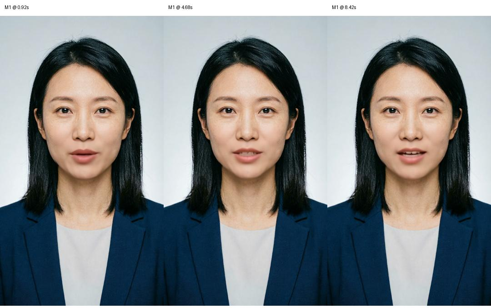

# MuseTalk 部署与首测结果

版本：v0.1 Actual Results · 2026-09-21。实验：MT-001。

**部署及真实推理已完成；生产选型仍为 UNSELECTED，完整视听尚未验收。**
已在用户租用的算力云实例中安装 MuseTalk 1.5，运行单图、动作母版、缓存复用和延迟音频四项任务。
四条原片均已下载至本机并通过媒体检查。没有调用新付费生成 API，没有使用失败 Demo 的代码或素材。

## 1. 直接查看样片

- [打开四条样片对比页](../../../experiments/MuseTalk部署/MT-001/样片对比.html)：有播放器和原 TTS 对照。
- [单图唇形原片 M1](../../../experiments/MuseTalk部署/MT-001/单图口播原片.mp4)。
- [动作母版首片 M2](../../../experiments/MuseTalk部署/MT-001/动作母版首片.mp4)。
- [缓存复用原片 M3](../../../experiments/MuseTalk部署/MT-001/缓存复用原片.mp4)。
- [延迟音频诊断片 M4](../../../experiments/MuseTalk部署/MT-001/延迟音频诊断片.mp4)。

M1 只用于唇形基线；M2～M4 的头动、眨眼等来自前一轮阿里生成的同身份短片，
属于“已有动作母版＋MuseTalk”的组合，不能把全部动作效果归于 MuseTalk 单模型。
本轮没有训练模型、生成新人物或新 TTS，也没有制作最终发布视频。

## 2. 真实部署环境

| 项目 | 实测记录 |
|---|---|
| 远端目录 | `/root/autodl-tmp/avatar-musetalk/MT-001` |
| 模型源码 | 官方 MuseTalk，commit `0a89dec45a0192b824e3cf4daf96c239440c5ed8` |
| 模型权重 | MuseTalk 1.5，官方 HF revision `3ef28bc5cff08c90ad8178a25f1b570cd800170f` |
| 系统 | Ubuntu 22.04.5 LTS |
| GPU | `nvidia-smi` 报告 NVIDIA GeForce RTX 4080，32760 MiB 显存，驱动 595.71.05 |
| 资源限制 | 容器 CPU 配额相当于 16 核；内存上限 66,571,993,088 字节，约 62 GiB |
| 存储 | 系统盘 30GB、数据盘 50GB；环境约 5.6GB、models 约 4.2GB、实验输出及缓存约 434MB |
| Python / CUDA | 独立 Python 3.10；torch 2.0.1+cu118、torchvision 0.15.2、torchaudio 2.0.2 |
| MMLab | mmcv 2.0.1、mmdet 3.1.0、mmpose 1.1.0、mmengine 0.10.7 |
| 其他关键依赖 | numpy 1.23.5、diffusers 0.30.2、transformers 4.39.2、huggingface_hub 0.30.2 |
| 媒体工具 | 实例安装 FFmpeg 4.4.2 |
| 用户提供价格 | 1.58 元/小时，未读取平台账单 |

GPU 型号与显存按实例报告记录；不据此断言与某款标准零售显卡硬件配置完全相同。
没有沿用原镜像中的 Python 3.12 / PyTorch 2.8；新环境与其他环境隔离。
完整版本：[environment.lock.txt](../../../experiments/MuseTalk部署/MT-001/远端证据/environment.lock.txt)。

### 2.1 已通过的部署检查

- `pip check`：无依赖冲突。
- PyTorch CUDA 可用，MMCV NMS 在 GPU 上真实执行。
- 官方人脸检测、DWPose 预处理模块加载成功。
- SoundFile 读取原 WAV 得到 224,640 个 24kHz 采样；librosa 按官方方式重采样后为 149,760 个 16kHz 采样，均为 9.36 秒。
- 远端 11 项权重/配置已记录摘要，四个 HF 大权重与官方固定 revision 的 LFS SHA-256 和大小一致。
- 上传后的原图、原音频、原阿里片与本地 SHA-256 一致；原始资产未改写。

证据：[权重清单](../../../experiments/MuseTalk部署/MT-001/远端证据/weights-manifest.json)、
[输入清单](../../../experiments/MuseTalk部署/MT-001/远端证据/inputs-manifest.json)、
[导入与 GPU 算子检查](../../../experiments/MuseTalk部署/MT-001/远端证据/logs/import-check.log)。

### 2.2 部署中实际处理的问题

实例无法直连 Hugging Face，镜像端点返回 403。核心 UNet 改从 ModelScope 镜像下载，
完整文件 SHA-256 与官方 HF 的 `7ebf6c98c181e20838e4c0054e96e944ac60d5d692cc01db42839fe11b787007` 一致。
其他组件采用官方文件/CDN，部分配置由本机下载后传入。人脸分割权重先在本机从官方指定 Google Drive 下载验证，
传输受阻后使用内容相同的镜像，整文件哈希再次匹配；原始来源与镜像元数据均保留。
没有下载或执行不明整合包，没有关闭 TLS 证书验证。

官方整套 requirements 包含训练、网页演示和 MoviePy 等本次 CLI 未直接使用的组件，
初始解析会下载 TensorFlow 等大包，因此停止该安装，改用可追溯的 CLI 推理依赖清单。
`chumpy` 的构建隔离缺少 pip 导致一次依赖安装失败，改为在独立环境中关闭其构建隔离后安装；
随后锁定 NumPy 等版本，全部导入验证通过。安装失败日志保留，不把它们算成模型推理失败。

## 3. 四项任务的输入与原始结果

所有任务为 fp16、batch size 4、25 fps；单图输入 1080×1920，动作母版为前轮阿里 720×1280 原片的 25 fps 派生副本。
母版转换保持时间尺度，不做生成式补帧；原阿里 MP4 保留。
M4 仅在原 TTS 前加 0.5 秒静音，原有 PCM 保持不变，总长 9.86 秒；用于诊断音频重新驱动，不参与主质量排名。

| 任务 | 真实结果 | 时间口径 |
|---|---|---|
| M1 单图 | 1080×1920，H.264/AAC，视频 234 帧 / 9.36 秒，音频 9.36 秒 | 进程完整墙钟约 99 秒，包含加载、推理、融合与编码，不含安装和传输 |
| M2 动作母版首片 | 720×1280，视频 233 帧 / 9.32 秒，音频与容器 9.36 秒 | 母版预处理约 106.014 秒，之后首条调用约 25.713 秒 |
| M3 同进程缓存复用 | 720×1280，视频 233 帧 / 9.32 秒，音频与容器 9.36 秒 | 从调用到输出约 22.841 秒；不含本轮模型启动与母版准备 |
| M4 延迟音频 | 720×1280，视频 245 帧 / 9.80 秒，音频与容器 9.86 秒 | 约 24.252 秒，口径同 M3 |

M2～M4 在同一进程完成，整体墙钟约 **197 秒**，其中包含加载、106 秒母版准备及三次合成。
重启进程仍需模型/缓存加载，不能承诺每次新启动也只花 23 秒。

M1 每秒一次整卡显存采样最大值为 **7489 MiB**，M2～M4 为 **7477 MiB**。
这是离散采样得到的最大整卡占用，不是 PyTorch 精确瞬时峰值，不能据此推荐只留 7.5GB 显存。
本次未采集可靠进程 RSS 峰值，不填写虚构 RAM 指标。

四条视频均通过 FFmpeg `-xerror` 完整解码检查；下载后逐文件 SHA-256 与远端一致。
没有增强、烧字幕、裁剪首尾或替换音轨。
原始测量：[M1](../../../experiments/MuseTalk部署/MT-001/单图媒体测量.json)、
[M2～M4](../../../experiments/MuseTalk部署/MT-001/母版媒体测量.json)。

## 4. 质量观察与发现的问题



M1 的嘴部随帧变化，整体身份、发型、服装和背景与输入相近；可见生成脸区比原图更平滑。
头部与眼睛基本保持同一姿态，不满足完整自然动作要求。1080×1920 是画布尺寸，脸区模型仍按 256×256 处理。


M3 与 M4 在对应时刻具有相近的源动作，但嘴型发生变化。M4 的 0.2 秒位于新增静音内，可见闭口，
与 M3 同时刻的说话嘴型不同；这支持“确实重新使用音频驱动嘴部”的局部观察，
仍不能代替全片逐音素视听、同步误差或自然度验收。

### 4.1 实时路径存在末帧遗漏

首次 M2/M3 的视频轨比音频短 40 毫秒，M4 短 60 毫秒。
定位到官方 `Avatar.process_frames` 在 `self.idx >= video_len - 1` 时提前退出，导致最后一帧未写入。
M4 还包含将 9.86 秒按 25 fps 向下取整的 20 毫秒，因此不能将全部 60 毫秒归因于同一个条件。
本轮原片与计时保持原样，不通过补帧或替换输出隐藏问题。清理修复、末帧边界修复与原始版本分开留证；
修复后仍需新任务验证真实输出，不能把首次测量改写成修复版成绩。

已新增 `scripts.realtime_inference_mt001_fixed`，只把该退出边界改为 `self.idx >= video_len`，
与首测计时入口并存。真实队列与像素数据的离线测试覆盖 1、2、234 帧：原代码分别少一帧，修复后数量/顺序正确。
加上普通推理清理测试，共 **7 项离线测试通过**；远端入口编译验证通过。
这份修复入口尚未重新进行 GPU 出片，后续任务应使用它并复核帧数；本轮不自动重复四项生成。

### 4.2 原音频保留与主观视听

原 WAV 的声明长度问题仍会使 FFmpeg 输出 `Packet corrupt` 告警，但 SoundFile、librosa 均读到完整采样，
M1 输出轨时长为 9.36 秒。将原音频与 M1 音轨解码到 24kHz 单声道后，
互相关的最佳时移为 0 毫秒，重叠区相关系数约 0.9995。
解码出的 AAC 采样包括尾部填充，不能把容器时长与解码采样数混为一谈。
这项结果支持 M1 音轨保持，**不是唇音同步测量，也不代表主观音色或字音已验收**。
测量见 [单图音轨核验](../../../experiments/MuseTalk部署/MT-001/单图音轨核验.json)。

本轮全片人类视听评审人数为 0；身份稳定、牙齿/唇缘伪影、语音完整性与自然动作仍标记 NOT_REVIEWED。
单图与母版是不同输入条件，不按同一画质排行榜直接排胜负；长片循环重复感、服装/背景变体和不同文案均尚未测试。

## 5. 费用：推理时间不等于账单

用户提供实例单价为 1.58 元/小时。到首次结果测量归档时，
从独立环境创建完成起观察到约 **0.998 小时**，对应实例时费约 **1.58 元**。
这个区间包含大部分部署、下载、排障与推理，但不包含用户此前已经开机的时间，
也不覆盖归档后继续开机的时间、存储等其他费用。实际账单未查询，仍待对账。

M1 和 M2～M4 两个推理进程合计 296 秒，按时费折算约 **0.130 元**；
M3 热态调用 22.841 秒折算约 **0.010 元**。这两项只表示相应时间段的算力时费，
不包含安装、启动分摊、母版、TTS、内容模型、存储、空闲和维护成本，**不是每条合格视频总成本**。
本轮没有已通过完整质量验收的产出，不计算“单位合格片成本”或长期省钱比例。

所有本轮模型进程已结束，归档检查时 GPU 为 1 MiB / 0% 利用率。
**实例仍开机，没有通过 SSH 关闭平台计费。** 暂时不用时需在平台控制台关机；停止模型进程和断开 SSH 都不等于停止实例计费。

## 6. 当前可用入口与后续边界

远端保留独立环境、固定源码、权重与缓存，可继续使用：

```text
/root/autodl-tmp/avatar-musetalk/MT-001/
  env/                    独立 Python 环境
  source/                 固定官方源码与本次入口副本
  source/models/          已核验权重
  source/inputs/          原始与明确派生素材
  source/configs/mt001/   本次固定任务配置
  source/results/         原始输出及 avatar 缓存
  logs/                   安装、推理、资源与计时证据
```

普通推理入口为 `scripts.inference_mt001`：增加经测试的临时目录保护，不改变模型。
实时首次测试入口为 `scripts.realtime_inference_mt001`：仅增加四处时间记录，保留首测代码版本。
后续实时推理使用 `scripts.realtime_inference_mt001_fixed`，其末帧补丁状态和验证边界见 4.1 节。
`run-M1.sh` 和 `run-M234.sh` 有已执行标记，不应删除标记或直接重复运行来覆盖本轮结果。
后续新任务必须使用新的任务/输出名；同一身份和同一动作母版可复用版本化缓存。

本次仅交付可运行的 CLI 模型环境与实测证据，没有部署公网服务、任务 API、生产调度、自动关机或抖音发布。
下一步先完整看听样片，确认唇形和脸部清晰度能否接受，再安排真正的新口播及 60～75 秒动作接缝测试。
MuseTalk 可以保留为自托管唇形候选；完整数字人组合是否选定，仍需上述质量和长期成本证据。

## 7. 可复查文件

- [本地部署记录](../../../experiments/MuseTalk部署/MT-001/部署记录.json)。
- [官方权重版本清单](../../../experiments/MuseTalk部署/MT-001/官方权重清单.json)。
- [普通推理清理补丁](../../../experiments/MuseTalk部署/MT-001/普通推理清理补丁.py) 与 [四项离线测试](../../../experiments/MuseTalk部署/MT-001/tests/test_cleanup.py)。
- [实时帧数补丁](../../../experiments/MuseTalk部署/MT-001/实时帧数补丁.py) 与 [三项帧数回归测试](../../../experiments/MuseTalk部署/MT-001/tests/test_frame_count.py)。
- [M1 执行回执](../../../experiments/MuseTalk部署/MT-001/远端证据/logs/M1-process.json)、[M1 GPU 采样](../../../experiments/MuseTalk部署/MT-001/远端证据/logs/M1-gpu.csv)。
- [M2～M4 执行回执](../../../experiments/MuseTalk部署/MT-001/远端证据/logs/M234-process.json)、[M2～M4 原始日志](../../../experiments/MuseTalk部署/MT-001/远端证据/logs/M234-inference.log)。
- 前置依据：[官方能力核验](MuseTalk官方能力核验.md)、[部署试验方案](03-MuseTalk云端部署与试验方案.md)。

报告与项目文件不保存 SSH 密码；私有下载地址没有复制进公开阅读版。
