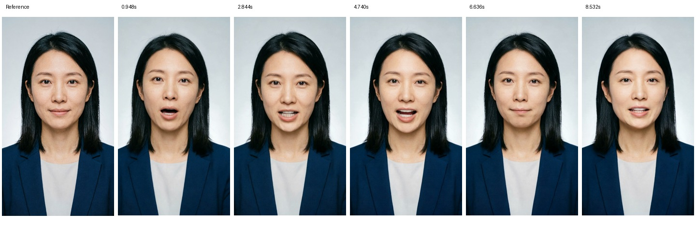

# OmniHuman1.5 开通后实测结果

日期：2026-09-21 · 实验：TH-COMP-003 · 技术选择：**UNSELECTED**。

用户开通 OmniHuman1.5 后，同一人物图、同一音频和相同参数的新请求已生成真实原片。之前两轮权限失败证据保留。本次仅新增一个火山生成任务，没有重新生图、合成 TTS、生成阿里/MuseTalk 视频或向抖音发布。

- [三方案可播放对比报告](../../../experiments/三方案口播对比/TH-COMP-003/三方案数字人口播对比报告.html)
- [火山原片](../../../experiments/三方案口播对比/TH-COMP-003/火山口播原片.mp4)
- [生成结果与时间记录](../../../experiments/三方案口播对比/TH-COMP-003/生成结果.json)
- [媒体测量与音轨核验](../../../experiments/三方案口播对比/TH-COMP-003/火山媒体测量.json)

## 1. 权限变化与调用证据

开通前 TH-COMP-002 返回 HTTP401/code50400，无任务 ID。用户随后明确告知“刚刚开通了OmniHuman1.5”；本次新请求返回 HTTP200/code10000，取得任务 ID，最终 CVGetResult 返回 `done` 及原片 URL。

程序没有修改凭据；新旧请求摘要相同。这支持“本次接口访问在开通具体服务后恢复”的判断，不需要再把错误笼统归因于密钥填错。不能仅据此推导账号所有火山产品权限均已具备。

- req_key：`jimeng_realman_avatar_picture_omni_v15`。
- 参数：`output_resolution=720`、`pe_fast_mode=true`、`seed=20260921`。
- 任务 ID：`eec24b86b5c211f197771c34da482ebc`。
- 提交 request_id：`20260921214703E552A5181B29561D4D7A`。
- 最终查询 request_id：`202609212150235B37B0CEDEDBC7D69B03`。
- 生成提交 1 次，查询 11 次，无自动重复提交。

原图/音频 URL 再次下载后与冻结输入摘要一致。查询返回的 HTTPS 媒体主机为 `v26-aiop.aigc-cloud.com`，旧下载白名单未覆盖。仅对本次成功回执中的精确 URL 放行下载，保留公网地址检查、TLS 校验、下载大小限制和文件摘要；没有放开任意域名，也没有修改旧轮白名单。见 [下载来源记录](../../../experiments/三方案口播对比/TH-COMP-003/火山原片来源.json)。

## 2. 实际规格

| 指标 | 实测结果 |
|---|---|
| 输入人物 | 原 PNG 1080×1920，SHA256 `6531d41f561927836d496c169e8c53751c93243aad9fb0d8e624ad4c73e4f135` |
| 输入 TTS | 原 WAV 9.36 秒、24kHz 单声道，SHA256 `3aa5637692cfb333e0594d949bae2522cd44f698fe40c87718c96163408411ba` |
| 请求档位 | 720P 快速模式 |
| 实际尺寸 | **704×1248**；不能写成 720×1280，也不是最终 1080×1920 成片 |
| 视频 | H.264，25 fps，237 帧，视频轨 9.48 秒 |
| 音频 | AAC，音频轨 9.36 秒 |
| 完整解码 | FFmpeg `-xerror` 返回 0，无错误输出 |
| 帧时间戳 | 237 帧，从 0.00 到 9.44 秒，帧间隔约 0.04 秒 |
| 原片 SHA256 | `7119a042efac8d7c73cb387ed2cb499de187745b67eac2f928a18d501b52f80b` |

原始视频未做增强、重编码、字幕合成或音轨替换。9.48 秒画面比 9.36 秒音轨长 120 毫秒，这是轨道时长差，**不等于嘴型误差**。

## 3. 耗时与估算费用

- 客户端提交开始：北京时间 21:46:59.971。
- 首次查询到成功：北京时间 21:50:21.417。
- 观测提交至成功：**201.44559 秒**，不含下载与测量。
- 上一次未完成查询开始到成功查询结束的间隔为 **17.052141 秒**；完成时点在本地观测下约落于提交后 184.393449～201.44559 秒。接口没有返回服务端完成时间，不能把 201.45 秒称为纯模型推理时长。

公开参考价为 1 元/生成秒，本次接口回执没有计费用量字段。按实测视频轨 `9.48 × 1` 得到名义估算 **9.48 元**；实际计费粒度、折扣及账单未知。新账本预留 20 元，**预留不是扣费**，没有挪用或重置此前实验账本。

三方案计时边界不同：阿里 163.388 秒来自服务端提交至完成；MuseTalk 99 秒是加载、推理、融合、编码的整个进程；火山 201.45 秒是客户端提交至成功查询。比较报告逐项标注，不将其称为统一硬件/统一过程的性能排名。

## 4. 画面与音轨观察

关键帧位于 0.948、2.844、4.740、6.636、8.532 秒。人物的黑色齐肩发、深蓝西装、浅灰背景与脸部外观总体接近原图，可见嘴部、表情和轻微头部姿态变化。脸部皮肤更平滑；五帧未见新增主体或明显缺肢，但不能证明全片身份、牙齿和唇缘都无瞬时伪影。

将输入与输出音轨解码成 24kHz 单声道 PCM 后，全波形最佳对齐为 **0 ms**，重叠区 Pearson 相关系数 **0.99996223**，未发现参考音频首尾未覆盖。AAC 解码样本可能含编码填充；此测量是音轨保持证据，不能替代完整试听，也不是嘴型同步测量。

详细观察见 [火山质量观察](../../../experiments/三方案口播对比/TH-COMP-003/火山质量观察.json)。完整人类视听评审尚未进行，质量状态仍为 NOT_REVIEWED / NOT_ACCEPTED。

## 5. 对选型的影响

三家目前都有同图同音频的真实短片，可以开始三路效果对照。火山接入阻塞在本次任务中已经解除，所有生产选型仍保持 UNSELECTED。

需继续比较口型音素、牙齿/唇缘、身份、自然表情动作、声音完整性和每条合格视频成本；之后再决定长稿与变体实验。当前 MuseTalk 单图动作不足，动作母版组合单列，不混入同图基线。

供应商回执 `aigc_meta_tagged=false` 原样留存，未删除或加工原片元数据；这不能据以宣称抖音标识要求已满足。最终发布包及平台标识另行验收。
