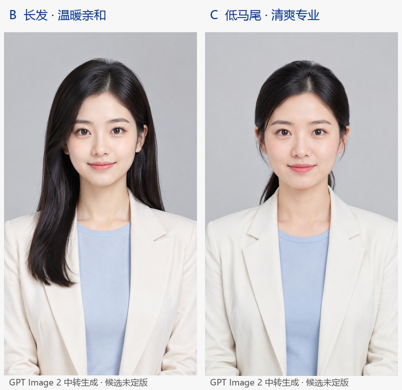

# 人物与音色首轮候选

更新：2026-09-22 · 实验：AV-001 · 状态：用户已确认人物 B＋音色 3（温暖闺蜜），技术生产质检待验收。

用户方向为“22岁左右的年轻女性，专业温柔”。选定模型为 GPT Image 2 专用中转与 MiniMax Speech 2.8 HD 官方接口。本次准备初始人物与系统音色候选，不生成视频或换装变体。

打开 [人物与音色选择页](../../../experiments/人物与音色选型/AV-001/人物与音色选择.html) 可查看原图与同稿试听。用户已明确确认人物 B＋音色 3；正式选择见 [定版记录](02-人物B与音色3定版记录.md)，浏览器内的草稿选择不覆盖该记录。

## 1. 实际可选素材

| 人物 | 方向与视觉观察 | 实际规格 | 选择与首轮观察 |
|---|---|---|---|
| B | 长黑发、米白外套与浅蓝上衣，正面闭唇微笑，温暖亲和；肤质偏平滑 | 941×1672 PNG；请求 1152×2048，尺寸未完全遵从 | **用户已选**；首轮视为审美候选的观察保留，原片保留，不用插值放大伪称模型原生达标 |
| C | 低马尾、正面闭唇、面部无遮挡，清爽专业且温柔；仍有生成图的平滑感 | 1152×2048 PNG，与请求一致 | 未选；首轮曾从面部可见性和知识讲解气质上优先建议，保留该历史观察 |

这是对静态图片的观察，不是精确年龄识别、身份一致性或数字人口播质量验收。两张图是不同人物候选，选定一位之后不混用两人的图像。

| 音色编号 | 官方名称与 ID | 同稿音频时长 | 技术与费用记录 |
|---|---|---|---|
| 2 | 淡雅学姐：`danya_xuejie` | 18.399438 秒 | WAV，32kHz 单声道，完整解码通过；148 计费字符，名义估算 0.0518 元 |
| 3（已选） | 温暖闺蜜：`Chinese (Mandarin)_Warm_Bestie` | 15.218844 秒 | WAV，32kHz 单声道，完整解码通过；148 计费字符，名义估算 0.0518 元 |

两段都使用 `speech-2.8-hd`、speed=1、vol=1、pitch=0、emotion=calm。名称和官方描述只提供筛选方向；用户已确认偏好音色 3，**术语读音、跨稿稳定性和长期听感仍待生产质检**，本轮不编造自然度评分。相同 speed 值不代表不同声音实际用时相同。

## 2. 试听文本与身份方向

显示文案：

> 你有没有发现，AI回答得很流畅，却不一定说得对。RAG，也就是检索增强生成，会先找资料，再组织答案。今天用三个步骤，带你看懂它。资料是否可靠，仍然需要检查。

原始 TTS 文本在第一句后插入 `<#0.30#>` 停顿，三项候选配置一致。它是术语、语气与停顿的选声基准稿，**不是一篇已经通过内容质检的完整发布稿**；“三个步骤”在此未展开。

三个人物提示词都要求明确成年、约22岁、真人摄影风格、自然五官与皮肤、米白外套、浅蓝上衣、浅灰背景、正面半身、完整头部和闭唇；仅人物脸型/发型设定不同。完整提示词保存在 [提示词目录](../../../experiments/人物与音色选型/AV-001/提示词/人物B.txt) 与 [C 提示词](../../../experiments/人物与音色选型/AV-001/提示词/人物C.txt)。

## 3. 失败与接入边界

原计划图片 A/B/C、音色 1/2/3 各提交一次。实际图片 A 和音色 1 在上一轮连接异常，未取得素材，状态保持 UNKNOWN_OR_FAILED，没有自动重试或删除执行标记。

本机无代理环境变量，但系统代理指向本地 127.0.0.1:7897；后续只读连接与 B/C、2/3 请求成功。A/1 未保存到可确认失败发生阶段的响应，不据后续网络恢复反推原请求一定未被供应商受理或一定免费。

成功请求证明：

- 图片兼容 `/v1/images/generations` 可返回可解码 Base64 PNG；B 输出尺寸不一致，C 符合请求。参考图编辑 `/images/edits` 尚未实测。
- B 回执没有 `model` 字段；C 回执写 `gpt-image-2`。均按请求模型记录，不能独立证明中转上游权重身份。
- 中转未取得可信价格或实际扣费。C 的 usage 全为 0 不代表免费；B 有 token 数但不能套用未核价格。
- MiniMax 官方 `get_voice` 返回 303 个系统音色，三项计划 ID 均在目录；两个实际语音请求返回业务成功、真实音频与计费字符。
- 两条成功 TTS 合计名义费用约 0.1036 元，账单待核；失败请求费用未知。

原始 private 回执可能含媒体数据/临时链接，不直接嵌入 HTML。公开证据见 [候选审查](../../../experiments/人物与音色选型/AV-001/候选审查.json)、[人物 B 响应摘要](../../../experiments/人物与音色选型/AV-001/执行证据/image_B/响应摘要.json)、[人物 C 响应摘要](../../../experiments/人物与音色选型/AV-001/执行证据/image_C/响应摘要.json)。

## 4. 已确认选择与后续验收

用户已明确确认“人物 B＋音色 3（温暖闺蜜）”。人物资产 ID 为 `av_base_b_v1`，声音档案 ID 为 `voice_minimax_warm_bestie_v1`；原图、基准音频与生成来源登记于 [角色档案](../../../assets/固定主播/主播B/版本1/角色档案.json)，详细证据见 [定版记录](02-人物B与音色3定版记录.md)。B 原图 SHA-256 为 `b66feb11d62559a632def9f86e0915645a70fa4dbb38c6a2cd2f7cb50b607b48`，尺寸仍为 941×1672；选择确认不消除尺寸偏差。

下一步使用人物 B 与音色 3 验证 MuseTalk 的同身份口型和 60 秒长视频，再验证同参考图服装/背景编辑。当前仅登记选择与固定资产，没有触发新的 API 生成或 GPU 任务。

选中资产与通过生产验收分开：当前没验证长片自然动作、换装一致性、口型、字幕或连续五条产能。原 Qwen 角色的动作母版不能当作这些新人物的母版。
